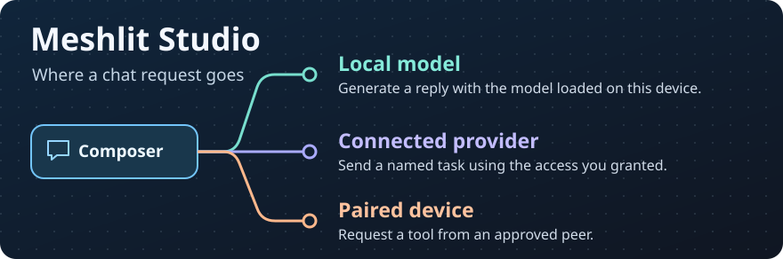
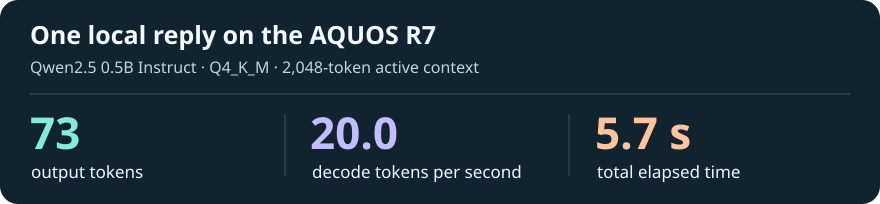

# Meshlit Studio

Run a local model on your phone, open a coding workspace on your desktop, or ask a connected provider to take a task. The chat composer brings the result back into the conversation. You choose the model, which tools it can use and which devices it can reach.

[Download Studio](#download-studio) · [First local chat](#first-local-chat) · [GUI guide](docs/GUI_WORKFLOWS.md) · [Build from source](#build-and-run) · [Feature map](FEATURE_MAP.md)



## Download Studio

Choose a package from the **v2.0.49-studio.2 preview**. The release includes a SHA-256 checksum for each download. [Release notes and checksums](https://github.com/sabbirimon/meshlit/releases/tag/v2.0.49-studio.2)

| Platform | Download | Package |
| --- | --- | --- |
| Windows x64 | [Windows installer](https://github.com/sabbirimon/meshlit/releases/download/v2.0.49-studio.2/Meshlit-Studio-Windows-X64-Setup.exe) | Single setup executable |
| macOS | [Apple Silicon](https://github.com/sabbirimon/meshlit/releases/download/v2.0.49-studio.2/Meshlit-Studio-macOS-ARM64.tar.gz) · [Intel](https://github.com/sabbirimon/meshlit/releases/download/v2.0.49-studio.2/Meshlit-Studio-macOS-X64.tar.gz) | Extract the archive and open Meshlit.app |
| Linux x64 | [Linux archive](https://github.com/sabbirimon/meshlit/releases/download/v2.0.49-studio.2/Meshlit-Studio-Linux-X64.tar.gz) | Extract the directory and run Meshlit |
| Android ARM64 | [Android APK](https://github.com/sabbirimon/meshlit/releases/download/v2.0.49-studio.2/Meshlit-Android-arm64-debug.apk) | Debug-signed preview for physical phones |

## First local chat

1. Open **Models** on Android or **Models & providers** in Studio. Select the bundled Qwen model and load it.
2. Open **Chat** and send a short prompt. The reply can show elapsed time, token count and decode speed when the engine reports them.
3. To try another model, open the Hugging Face catalog, select a repository and inspect the available files. Public, ungated downloads work as a guest. For a gated model, sign in and check access on the publisher’s model page.

## What you can do

| From the workspace | Try it |
| --- | --- |
| **Chat and create** | Ask a local model a question, delegate a named task to a connected provider, or preview a returned attachment before saving it. [Composer guide](docs/GUI_WORKFLOWS.md) |
| **Choose a model** | Inspect architecture, quantization, file size and context when available. Import a local file or connect an existing LM Studio or Ollama server. [Desktop model management](docs/desktop/FULL_STUDIO.md#managing-models-in-native-studio) |
| **Pair a device** | Pair nearby devices or enter a Studio device ID through a configured internet relay. Compare identities and approve the request on the receiving desktop. [Android pairing and reconnect](docs/GUI_WORKFLOWS.md#pair-an-android-phone-with-studio-over-the-internet) |
| **Code on desktop** | Choose **Open coding IDE**, open a folder and use the integrated terminal. The bundled Zig toolchain includes C and C++ compiler drivers. [Native Studio guide](docs/desktop/FULL_STUDIO.md) |
| **Give an agent a tool** | Configure a tool or provider, grant access and inspect its result in chat. Permissions depend on the tool, actor and device. [Operating rules](docs/RULEBOOK.md) · [Client hub](docs/CLIENT_HUB.md) |

## On real devices



The AQUOS R7 had 12 GB of RAM and a Snapdragon 8 Gen 1. Decode speed measures output generation. Total elapsed time also includes work before the first token. Both numbers above describe the same reply. [Chat screenshot, model card and native runner measurements](docs/evidence/2026-11-24-aquos-r7/README.md)

On a Samsung Galaxy A20s, the phone paired with Studio on a Mac over LTE using the public relay and free WARP. After the app restarted, it verified the saved desktop identity. A separate desktop provider check returned a generated FLUX image to the chat preview. [Samsung reconnect capture](docs/evidence/2026-11-24-live-providers/samsung-relay-reconnected.png) · [Generated image](docs/evidence/2026-11-24-live-providers/flux-sailboat.webp)

## How the pieces connect

| Component | Implementation | Scope |
| --- | --- | --- |
| Android app | Kotlin, Jetpack Compose and native inference code | Phone UI, model management, permissions and device services. [Android and desktop parity](docs/ANDROID_DESKTOP_PARITY.md) |
| Native Studio | Rust launcher, VSCodium workbench, JavaScript extension and native llama.cpp server | Desktop chat, coding and local model serving. The desktop package runs without a JVM. [Migration details](docs/desktop/NATIVE_MIGRATION.md) |
| Layer placement | C admission kernel and optional Goose host experiment | Estimates how to distribute model layers across workers with different budgets. [Goose planner source](companions/pipeline/layer-placement.goose) · [Pipeline execution and recovery](docs/layer-pipeline-and-recovery.md) |
| HyperL™ | Separately licensed compute workbench and standalone engine | CPU recipes, native kernels and hardware experiments. [Meshlit integration](HYPERL.md) · [Standalone HyperL project](https://github.com/sabbirimon/HyperL) |

GitHub’s language chart counts source bytes on the default branch. The Android app and shared modules still account for much of Meshlit’s Kotlin. The Goose experiment is a single host-side planner. For clustering, device pairing establishes identity first. Running layers of an oversized model across multiple physical phones still requires a reproducible hardware demonstration. [Architecture](docs/architecture/current-state.md) · [Release evidence](docs/RELEASE_EVIDENCE.md)

## Build and run

Use **JDK 21**, Android SDK **37**, Python 3, Git and the checked-in Gradle wrapper.
The application requires Android 7/API 24 or later. Current APK targets are
ARM64 phones and x86_64 emulators; runtime support still depends on ABI, memory,
OS and available backends. Tool versions are pinned in
[libs.versions.toml](gradle/libs.versions.toml); do not downgrade them to match old guides.

```sh
git clone https://github.com/sabbirimon/meshlit.git
cd meshlit
# Configure JAVA_HOME and ANDROID_HOME for your installed JDK/SDK.
sdkmanager 'platforms;android-37.0' 'build-tools;37.0.0'
python3 scripts/prepare-bundled-model.py
./gradlew :app:assembleMeshlitV1Debug :app:assembleMeshlitV2Debug \
  --max-workers=2 -Pkotlin.compiler.execution.strategy=in-process
```

The preparation script downloads the **real revision-pinned 491,400,032-byte GGUF**
and verifies size/hash. Model weights, APKs, credentials and build outputs are
excluded from Git. Review [model provenance](app/src/main/assets/models/README.md).
Fresh builds need network access for declared dependencies and the pinned asset.
Both flavors share the current main UI; some legacy tools remain.

```sh
adb install -r app/build/outputs/apk/meshlitV1/debug/app-meshlitV1-arm64-v8a-debug.apk
# Use the x86_64 APK instead for a matching emulator.
```

Open Models, confirm Bundled/Installed, load the starter and send a short prompt.
Grant optional permissions only for features you enable. Startup loading uses the
remembered installed model after SDK initialization and resource checks.

### Build experimental native layer workers

For native CPU checkpoints and pipeline execution, install CMake plus Android
NDK 28.2.13676358, then build the pinned optional source for each required ABI:

```sh
python3 scripts/sync-optional-sources.py runanywhere-llama
python3 scripts/build-pipeline-native.py --android --abi arm64-v8a \
  --ndk "$ANDROID_HOME/ndk/28.2.13676358" --jobs 2
# Repeat with --abi x86_64 for an emulator, then rebuild the APK.
```

CPU Android is the tested native path. Compiler switches for CUDA, ROCm, Metal,
Vulkan, OpenCL, SYCL, MUSA or CANN do not establish usable device acceleration.
Read [build instructions](AGENT_BUILD.md) and [host proof procedure](docs/layer-pipeline-and-recovery.md)
before treating an adapter or placement plan as execution evidence.

### Tests

```sh
./gradlew :core-observability:testDebugUnitTest :core-inference:testDebugUnitTest \
  :core-mcp:testDebugUnitTest :core-cloud-mcp:testDebugUnitTest \
  :app:testMeshlitV1DebugUnitTest :app:testMeshlitV2DebugUnitTest \
  :app:lintMeshlitV1Debug :app:lintMeshlitV2Debug
python3 scripts/validate-feature-map.py
python3 -m unittest discover -s companions/crawler/tests -v
```

## Auditing and privacy

Under **Settings → Audit and telemetry**, you can enable encrypted local history, set retention and export metadata to JSONL or CSV. Optional OpenTelemetry export sends metadata to a collector you configure. Meshlit audit collection and export default off. A development build of the RunAnywhere SDK separately attempted to reach its telemetry endpoint. Online providers and remote tools contact the destinations you select. [Audit setup](docs/AUDIT_TELEMETRY.md) · [Privacy policy](docs/PRIVACY_POLICY.md) · [Terms of use](docs/TERMS_OF_USE.md)

## Guides and contributions

- **Using Meshlit** — [Desktop and Android GUI walkthrough](docs/GUI_WORKFLOWS.md) · [User manual](docs/USER_MANUAL.md) · [Operating rules](docs/RULEBOOK.md)
- **Working on the source** — [Build guide](AGENT_BUILD.md) · [Contributor guide](CONTRIBUTING.md) · [Documentation index](docs/DOCUMENTATION_STATUS.md)
- **For AI coding agents and evaluators** — [Repository instructions](AGENTS.md) · [Machine-readable feature inventory](docs/feature-map.json) · [Discovery index](llms.txt)

To contribute a hardware result, include the device, build, model and quantization, active context, steps and observed outcome. Pairing records, chat timings and layer-execution results answer different questions. [Physical device test guide](docs/physical-device-test-guide.md)

## License and upstream credit

Meshlit's application source retains its existing [Apache-2.0 license](LICENSE).
The separate [core-hyperl](core-hyperl/LICENSE) alpha.6 module contains newly covered
HyperL Community and Enterprise licensed code, with earlier Apache grants preserved.
See [its scope and modifications](core-hyperl/MODIFICATIONS.md). Third-party
components keep their own licenses and notices. RunAnywhere, llama.cpp, Compose,
OpenTelemetry, JSch, CodeMirror and the optional Crawl4AI/Soup/OpenClaw integrations
are credited in their module/source documentation. Optional source revisions and
licenses are recorded in [sources.lock.json](vendored/sources.lock.json).
Stryker supplied product inspiration; GPL source/assets were not copied into this
Apache-2.0 implementation. No upstream project endorsement is implied.

Meshlit is a project by IMON. [Authors](AUTHORS.md) · [Notices and artwork credits](NOTICE)
