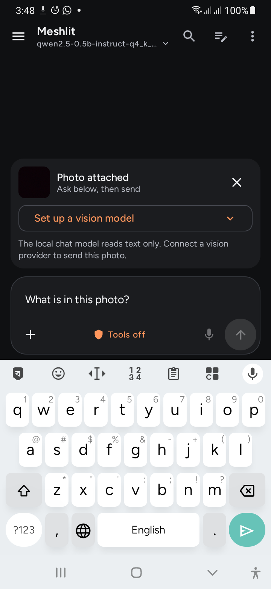

# High-impact work and remaining acceptance
<!-- meshlit-document-tracking:start -->
Tracking reconciled 2026-10-12: [Plan](../PLAN.md) · [Progress](../PROGRESS.md) · [Document status](DOCUMENTATION_STATUS.md).
Scope: Android/shared reference; desktop ports have separate acceptance. Phase labels in older sections retain their original scope.
<!-- meshlit-document-tracking:end -->

Updated 2026-10-24. The owner requested the most consequential or complex work first and a calmer UI like Kandari. This is an ordered backlog, not a completion percentage. Kandari's local design guide was reviewed for spacing, clear hierarchy, quiet rounded controls, and accessible tap targets; its app code was not changed.

| Priority | Work | Current state | Required completion evidence |
| --- | --- | --- | --- |
| 1 | Reliable everyday chat, photo and voice | Photo requests now use the chat controller, selected provider, ordinary Send/Stop, history and provider-reported usage. Compact voice controls and a five-destination mobile dock are implemented. | Both flavor tests/lint, physical layout checks, real provider image answer, spoken offline recognition and audible reply. Larger local-model quality remains open. |
| 2 | Genuine multi-device model execution | Android native layer binaries, offers and pinned worker enrollment exist. | Independent coordinator plus two workers: actual layer contribution, oversized model, cancellation, worker loss, resource readings and honest recovery behavior. A single-device or loopback run does not close this. |
| 3 | Internet membership and Mesh chat | Direct LAN/VPN/private transport and single-peer paths exist. | Authenticated reverse layer relay through NAT; multi-member encrypted chat with acknowledgements, offline queues and revocation; independent physical hostile-pairing tests. |
| 4 | Agents and Studio parity | Android typed jobs, scopes and tools exist; Studio has a host-client subset. | Durable desktop worker RPC and agent/MCP/hook controllers, cancellation/recovery, common grants/audit, real server/container execution. Menus do not establish backend parity. |
| 5 | RAG, models and operational runtimes | Model imports/downloads and Android reference tools exist. | Reliable document ingestion/source attribution; native local vision; download failure/resume/storage tests; real training/evaluation; OS-qualified VM/container controllers and cloud account/billing evidence. |
| 6 | Rewards and costs | Local nontransferable receipts and a monetary design exist. | Authoritative meters for every rewarded service, reciprocal receipts, replay/duplicate/fraud resistance, independent verification and settlement/legal/provider gates before monetary trading. |

## Current photo flow

- Select or capture one photo. No network request is made on selection.
- The attachment shows a preview and the chosen provider/model. If none is configured, its setup button remains visible and Send stays disabled.
- Type the question in the usual composer, or send with the default description question. Photo questions are bounded to 4,000 characters.
- Send submits directly to the reviewed OpenAI-format vision model. A separate loaded text model is not required. The provider must actually support images; protocol compatibility alone does not establish vision capability.
- Stop cancels the chat's media request. Provider changes while queued are rejected. An interrupted/failed request is not stored as a successful model answer.
- The answer, provider/model attribution and any actual reported usage enter conversation history. Original image pixels and temporary file paths are not serialized into history. Temporary camera captures are removed after success/removal; abandoned captures are bounded by existing age cleanup.
- Generic local VLM support and arbitrary PDF/Office/audio/video chat readers remain pending.

## UI scope

Android V1/V2 share the compact dock, two-row composer, inline photo model selector, smaller icons and compact manual voice controls. Existing theme/font preferences remain. The keyboard hides the dock; attachment and voice panels have bounded scrolling. The advanced drawer remains available. Studio needs its own visual and backend port; this change does not establish desktop parity.

## CI baseline

The preceding build43 V1 and V2 debug assemble/unit/lint stages passed on GitHub. The V2 job later timed out in the separate Core Candidate stage. That candidate gate remains unresolved; do not report the overall CI run green.

## Hardware-aware model recommendations

Models now compares total and available RAM, current free storage, Android/API/ABI, low-RAM status, CPU core count, installed backend and thermal readings. Best fit and Save storage use different rankings. The UI refreshes observations while open; downloading rechecks storage and hardware. Advice is a conservative estimate, with actual load validation still required. GPU/NPU acceleration is never inferred from a chipset name. No model downloads on first launch without a user action.

Verified public metadata on 2026-10-24 supplies pinned revisions and SHA-256 for:

- [Qwen3 0.6B Q4_K_M](https://huggingface.co/unsloth/Qwen3-0.6B-GGUF): 396,705,472 bytes, compact option.
- [Qwen3 1.7B Q4_K_M](https://huggingface.co/unsloth/Qwen3-1.7B-GGUF): 1,107,409,472 bytes, balanced reasoning candidate.
- [Qwen2.5 1.5B Instruct Q4_K_M](https://huggingface.co/Qwen/Qwen2.5-1.5B-Instruct-GGUF): 1,117,320,736 bytes, general-chat alternative.
- [Qwen3 4B Q4_K_M](https://huggingface.co/Qwen/Qwen3-4B-GGUF): 2,497,280,256 bytes, high-memory candidate.

The planner reserves twice the download size plus 256 MiB for possible SDK copies and headroom; this is not the total storage used by Meshlit's existing APK/models. The first-run empty chat offers a dismissible link to these recommendations. Existing model loading and checksummed resumable downloads remain in use. Fast Qwen3 ChatML uses an empty thinking prefix; `/think` requests a thinking turn. The [official model card](https://huggingface.co/Qwen/Qwen3-0.6B-GGUF) describes thinking/non-thinking behavior. Meshlit's current output cap can truncate long reasoning; neither benchmarks nor phone generation are established by the recommendation.

[DeepSeek R1 Distill Qwen 1.5B](https://huggingface.co/deepseek-ai/DeepSeek-R1-Distill-Qwen-1.5B) was reviewed as an alternative, but its different prompt format and long reasoning need separate runtime qualification. The curated recommendation flow uses Qwen options in this iteration; it does not claim to have added DeepSeek support.

## Physical checks for build44

Samsung displayed its actual hardware and the compact recommendation. Its explicit download of Qwen3 0.6B completed and matched the pinned SHA-256. Load/generation qualification remains pending; the other active Kandari chat resumed use of the phone. Photo capture, missing-model setup, photo/draft retention across setup, keyboard layout, and offline voice manual Start/Stop were exercised. No real vision-provider answer or spoken conversation was established. Android Back from provider setup still passes through Settings; returning through the Chat dock preserves the attachment. Xiaomi received the APK in Downloads, but its installation and UI are not qualified by that copy.

This screenshot shows a captured test photo with no configured vision provider. It is layout evidence, not image-understanding evidence.

## Completed local validation

- V1 and V2 debug APK assembly and lint passed; each lint report has zero errors, 399 warnings and 19 hints. No lint checks were disabled.
- App unit suites: 229 tests per flavor; core inference: 284 tests; no failures. The required MCP (139), sandbox (14), and network (46) suites were confirmed up to date with no failures.
- Crawler: nine tests passed in its disposable test environment. Documentation tracking, feature-map, HyperL provenance and diff whitespace checks passed.
- ARM64 build44: 566,925,570 bytes, SHA-256 `500d2f7e3f11a10974d5642c59a16a9e232492ac89175ba447b29fc50444ae08`. Debug signature and pinned bundled Qwen asset verified; Xiaomi Download copy matches. This is a test APK, not a production qualification.

## Current source continuation (not yet a new delivered APK)

See [PROGRESS.md](../PROGRESS.md) for cause/fix/test records. Durable bounded text RAG now has shared retrieval logic, Android encrypted import/source labels and a Studio password-unlocked encrypted vault. Explicit local/remote/agent grants govern reuse. This closes the source stub for these text flows, not PDF/Office parsing, semantic embeddings, remote vector-service qualification or training. Studio model recommendations share Android artifact pins and use actual host capacity. HyperL now validates native snapshot overhead and offers bounded repeated CPU measurements.

Samsung build44 loaded Qwen3 0.6B and greeted normally. A fast-mode arithmetic case failed (17+25 →32); explicit reasoning later returned42. SDK token counts remain deliberately unavailable because their provenance was previously disproven. Latest source fixes and all broader acceptance rows above remain subject to final tests and device checks.
