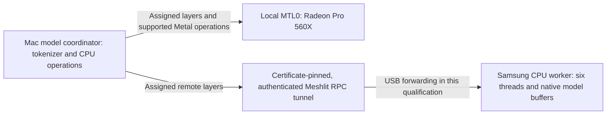

# Physical Mac GPU and Samsung layer execution
<!-- meshlit-document-tracking:start -->
Tracking reconciled 2026-11-06: [Plan](../PLAN.md) · [Progress](../PROGRESS.md) · [Document status](DOCUMENTATION_STATUS.md).
Scope: Android/shared reference; desktop ports have separate acceptance. Phase labels in older sections retain their original scope.
<!-- meshlit-document-tracking:end -->

2026-11-02 qualification of the pinned native runtime. This is a development
execution proof, separate from automatic cluster provisioning and the Studio GUI.

## Actual execution

The Mac coordinator loaded the existing Qwen2.5 0.5B Q4_K_M GGUF, SHA-256
`74a4da8c9fdbcd15bd1f6d01d621410d31c6fc00986f5eb687824e7b93d7a9db`.
The native revision was `4df29be4f4c3673f428170fda944a5b19f743bb8`.

- Layer assignments 0–18 used local `MTL0`; 19–24 used the Samsung `RPC0` route.
- Native model-buffer metadata reported `MTL0_Mapped` 235.64 MiB and Samsung RPC
  186.51 MiB, plus coordinator CPU mappings. These can overlap mapped file pages;
  summing them is not a measurement of unique physical RAM or private VRAM.
- Metal encoded actual MUL, ADD, ROPE, SET_ROWS and CONT operations. Unsupported
  GPU operations used the coordinator CPU through the local native scheduler.
  No GPU matrix multiplication capability is claimed for this Radeon path.
- The same Samsung native worker increased from 2,524 KiB RSS / 3 CPU ticks to
  198,852 KiB RSS / 2,101 ticks. This is the owned worker process, distinct from
  the application process and configured worker count.
- Actual completion returned `4`, native token IDs `[19, 151645]`, 28 evaluated
  prompt tokens and 2 predicted tokens.

The coordinator used explicit local `MTL0,RPC0` devices, layer split `3,1`, context
256, two coordinator threads, f32 KV, flash attention off and repacking off. The
phone reported six worker threads. The real app supplied worker TLS identity,
pairing authentication and capability metadata; raw native RPC stayed on loopback.

See [the complete qualification record](desktop/evidence/mixed-mac-samsung-native-20261102.json).
One verification check initially assumed the wrong buffer prefix (`Metal0`
instead of `MTL0`) and GPU matrix support. The record preserves that failed check
and the corrected evaluation of saved actual placement, operations and process
samples. It does not replace model output or invent a second execution.

## Supported boundary

This proves one real model completion with different layers on two physical
devices and supported GPU operations on the Mac. It does not prove an oversized
model, arbitrary shared memory, private-VRAM pooling, replicated recovery, hot
repartitioning, automatic provisioning or faster execution. Startup took 15.52 s
and the single request 13.48 s under concurrent development activity; these are
observations, not a fair benchmark against local execution.

The working topology keeps Metal local to the coordinator. The experimental
all-RPC topology failed twice on this hardware: private Metal uploads hit an
alignment assertion, and explicit shared Metal buffers reached an unsupported
RMS_NORM operation. The pinned RPC backend advertises all operations as supported;
it does not negotiate the remote Metal operation set. No vendored source was
patched or hardware fallback hidden to pass this proof.

HyperL's independently installed native adapter currently selects either exact
local GPU devices or an RPC-only cell. It does not yet expose this mixed local
Metal/RPC topology through its profile validation. Its integration needs an
explicit qualified mixed adapter and real allocation/lifecycle wiring. Keep the
separate HyperL Community licence and the distinct vector-runtime qualification.

## WAN and product acceptance

At the initial USB qualification, the Samsung offered a global mobile IPv6 address, but direct HTTPS enrollment
from this Mac failed with `NoRouteToHostException`. Live 4G WAN remains pending a
reachable approved host or relay. The successful physical execution used USB
forwarding and cannot qualify WAN transport.

The later Tailscale native WAN qualification below supersedes the pending native-transport gate. The earlier direct-IP failure and USB-only result remain historical evidence; they are not relabeled as WAN success.

Actual WebBridge pairing checks over that USB transport passed: pending devices
were denied, an isolated test device approved only for OBSERVE could read status
and real resources, and its MODEL_UNLOAD request was denied. The fixture restored
the original firewall, public endpoint and startup preference, stopped native/web
services and deleted temporary enrollment credentials. Existing owner enrollments
were unchanged.

Studio and Android can already select configured compatible model/cluster
endpoints. A profile remains distinct from starting this native coordinator.
Shipping the tested topology as a managed Studio/HyperL cluster requires explicit
device capability negotiation, admitted memory allocations, process ownership,
Stop/revocation and failure qualification; a dashboard label is not that runtime.

## Supplied public-IP WAN retest — 2026-11-02

After the owner explicitly requested another attempt, the phone's real WebBridge
TLS listener was started through its existing UI. The supplied global IPv6 matched
the cellular interface. The phone's IPv4 interface was `192.0.0.4/32` on
`v4-rmnet_data4`; the supplied public IPv4 was not directly assigned to it. This is
consistent with IPv4 translation over IPv6, rather than a directly numbered public
IPv4 listener. The address range is defined for IPv4 service continuity in
[RFC 7335](https://www.rfc-editor.org/rfc/rfc7335.html).

With `*:18792` observed listening, a USB baseline verified the exact phone
certificate pin and validity. HTTP then returned 403 under the unchanged port
rules. The public IPv4 connection timed out after 5.01 s, and the supplied global
IPv6 failed with EHOSTUNREACH before TLS. The app's HTTP policy cannot explain
failure before TCP/TLS; these results do not identify the particular upstream
carrier, translation or routing restriction. No public enrollment was possible.

The test stopped the temporary listener, restored the original empty public
endpoint, removed its temporary USB forward and confirmed Accessibility stayed
bound. It changed no network rules, existing enrollment, model, keyboard or CPU
policy. This avoids another force-stop/instrumentation cycle. [Live test and
cleanup evidence](desktop/evidence/samsung-public-ip-wan-20261102.json).

## Real Tailscale / LTE layer execution — 2026-11-03

The owner joined the official Mac and Samsung clients, then explicitly approved a temporary native-worker WAN grant and TCP 50551 rule. The worker's QR was decoded only in private test storage; its full certificate matched the earlier physical qualification. Native traffic routed through the Mac's Tailscale interface to Samsung on LTE with Wi-Fi disabled. USB remained a developer control/metrics channel, with no native RPC or HTTPS data forward.

The same existing Qwen2.5 0.5B file and native revision produced correct text `4` and token IDs `[19, 151645]`. Native placement assigned 19 layers to local MTL0 and six to phone RPC0. Buffer metadata reported 235.64 MiB MTL0_Mapped and 186.51 MiB remote RPC. The same owned phone process grew from 2,572 to 198,848 KiB RSS and from 2 to 2,140 CPU ticks, with actual supported Metal operation encoding on the Mac. Mapped buffers can overlap file pages; their sum is not unique physical RAM or private VRAM. Setup took 84.406 s and generation 29.011 s; these are single-run observations, not a fair speed comparison.

The initial capability attempt was denied by listener policy; restarting the worker recovered a valid authenticated read. Its exact earlier capture/policy timing is unproven and the failed attempt is retained separately. In a controlled second request, remote CPU activity and a pending request were observed before terminating the owned TLS bridge. The coordinator exited and the request reported RemoteDisconnected after 3.577 s. Phone worker RSS fell to 3,232 KiB and a fresh pinned capability check succeeded. No generation was automatically replayed. This is connection-loss evidence, not an OS Wi-Fi/4G transition or transparent resume test.

Cleanup stopped both owned Mac processes and the phone worker/TLS listener, restored the exact original port policy and worker WAN setting, removed temporary credential/QR files, and verified Accessibility still connected and the owner Qwen3 model ready. No model, CPU, startup or keyboard preference was changed. This development topology uses one remote worker plus the Mac's local Metal/CPU; the managed UI's multi-worker admission and HyperL adapter still have separate acceptance. See [the full WAN record](desktop/evidence/mixed-mac-samsung-wan-native-20261103.json) and [the initial failed attempt](desktop/evidence/mixed-mac-samsung-wan-native-attempt1-20261103.json).
