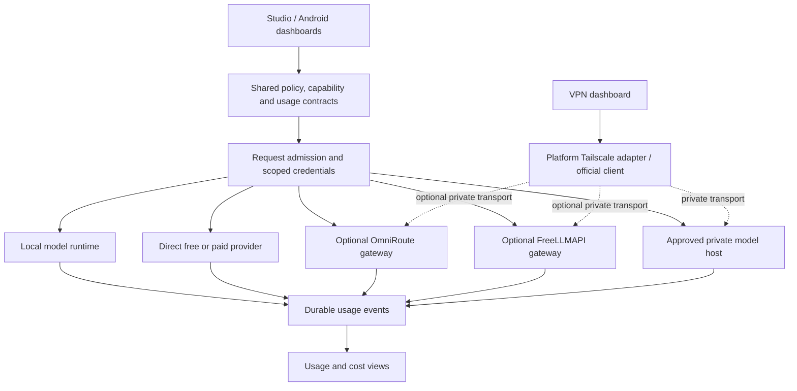

# Meshlit Studio and mobile LTS plan
<!-- meshlit-document-tracking:start -->
Tracking reconciled 2026-10-12: [Plan](../PLAN.md) · [Progress](../PROGRESS.md) · [Document status](DOCUMENTATION_STATUS.md).
Scope: Android/shared reference; desktop ports have separate acceptance. Phase labels in older sections retain their original scope.
<!-- meshlit-document-tracking:end -->

Planning baseline: 2026-10-26, Asia/Dhaka. Status: **implementation started, first dashboard/navigation increment locally validated; backend and physical acceptance remain open**. The owner selected “Plan first, then implement,” then authorized baseline checks and step-by-step implementation. This document incorporates the requests for optional gateways, free and paid services, dedicated dashboards, detailed usage, Studio parity, a gentle premium interface, minimal Basic settings and scenario-based automatic tuning. The original planning pass changed no application or service. Current implementation evidence is recorded in [the baseline report](desktop/STUDIO_BASELINE_2026-10-26.md).

## G1 hardening continuation — 2026-10-26

The durable journal now validates persisted accounting and refuses further use after ambiguous storage failure until reopened. Android profile/key mutations use a checked encrypted transaction and pre-dispatch binding revalidation. G1 remains partial: Studio interactive hosts now have optional durable credentials (see the usage guide), while broader adapter/grant revocation, schema evolution and live qualification remain open. [Research and concrete verification improvements](MATH_RESEARCH_2026-10-26.md) do not authorize automatic routing or claim invoice caps.

## Current VPN increment (2026-10-26)

G4 now has source adapters: bounded Studio CLI status, Android app-effective VPN observations and official-client handoff. Basic settings remain unchanged and technical details are collapsed. No automatic VPN/exit-node mutation or unsupported Android Tailscale identity claim is added. [Setup and qualification limits](TAILSCALE_AND_VPN.md) distinguish observed status from host reachability and physical proof.

## Current usage increment (2026-10-26)

Shared encrypted usage history, decimal currency budgets, atomic request reservations, interruption recovery and manual reconciliation are implemented for Android online-provider text calls and Studio interactive chat. Optional OmniRoute/FreeLLMAPI presets use the existing compatible transports, without upstream source imports or automatic fallback. See [scope and setup](USAGE_AND_MODEL_BUDGETS.md). G1/G2 remain partially open: no cross-device authority, automatic invoice reconciliation, all-adapter coverage, authenticated free-tier proof or live gateway qualification. The source baseline tables below describe the pre-implementation audit.

## 1. Product decisions

Meshlit remains useful offline and with direct providers. OmniRoute and FreeLLMAPI are optional connections, independently enabled and removable. Neither becomes a mandatory dependency, account broker or source of assumed free tokens. Both free and paid services can be configured directly or through a compatible gateway.

Build four dedicated management destinations: **Models**, **Routing**, **Usage & Costs**, and **VPN & Network**. Keep Chat immediately accessible. Devices and the HyperL workbench remain distinct tools. Move routine work out of the settings catalogue and into these destinations. Basic settings contain a small set of user choices; Advanced contains technical policy and diagnostics.

Studio must gain real backend parity in a measured order. Copying Android menu entries or showing inactive toggles does not close a parity item. Mobile first means Android for this cycle; iOS and HarmonyOS NEXT need separate implementation and qualification. Intel Mac remains the desktop qualification baseline; Windows, Linux and Apple Silicon are separate package/device gates.

LTS is a proposed maintained product channel, not a label for the present beta. Experimental cluster, unsupported accelerators and experimental gateway adapters must not block a qualified local/core release or silently become its dependencies.

## 2. Git and source baseline

The current home is [sabbirimon/meshlit](https://github.com/sabbirimon/meshlit), checked out at `/Users/code/Documents/Codex/meshlit-unified`. At inspection, the working tree was clean and local `main` matched fetched `origin/main` at `5a7c5167ce6a32880c4e6354fde26af50773eb2c`. Planning changes are on `plan/studio-mobile-lts`. No push or release is part of this pass.

- `origin` is the unified repository; `v2` points to the historical `sabbirimon/meshlit-v2` repository. Preserve both histories.
- No open PRs were returned for the unified repository at inspection.
- [Latest multiplatform preview run](https://github.com/sabbirimon/meshlit/actions/runs/40057473856) succeeded. [Latest full CI run](https://github.com/sabbirimon/meshlit/actions/runs/40057473850) was cancelled after about one hour. The preceding full CI run succeeded. Do not infer a clean current Android qualification from those mixed results.
- `meshlit-v2-dev` and `meshlit-v2-update` were clean older checkouts on their own branches. `mllm-repair` and `meshlit-release-build41` are not Git checkouts at their roots. Do not implement into those artifact/older trees.
- The October 24 paused checkpoint remains historical evidence. This new request authorizes planning; application work remains deferred by the owner's plan-first selection.

### Verified source anchors

| Area | Existing source | Remaining gap |
| --- | --- | --- |
| Android providers | `app/.../providers/OnlineProviders.kt`, `core-inference/.../models/OnlineModelClient.kt` | Encrypted profiles and direct protocol calls exist; no unified durable usage/budget service. Buffered calls, HTTPS-only profiles and current request limits need deliberate compatibility handling |
| Android routes | `app/.../routing/ModelRoutes.kt`, `app/.../ui/modern/ModelRouterScreen.kt` | Saved scenario routes, chains and comparisons exist; automatic fallback and shared Studio policy are not implemented |
| Studio remote models | `desktopApp/.../HostClient.kt`, `DesktopDestinations.kt` | Compatible hosts exist, but Studio router is explicitly pending; native provider/credential/agent parity is incomplete |
| VPN | `core-tunnel/.../TunnelSpec.kt` | Configuration type and in-memory registry exist; no Tailscale client is implemented there |
| UI | Android `WorkspaceNavigation.kt`, `ModernSettingsScreen.kt`; Studio `WorkspaceChrome.kt`, `Main.kt`, `Search.kt` | Separate UI implementations; a shared design specification and destination/task hierarchy are needed |
| Usage | `OnlineReply`, route-step replies, Studio `GenerationUsage` | Some reported tokens and estimates exist; SDK counters may be unavailable. No complete cross-platform usage ledger, billing reconciliation or atomic spend admission |
| HyperL | `core-hyperl`, `desktop-hyperl`, Studio `DesktopHyperL.kt`, Android `HyperLScreen.kt` | CPU integration exists; latest UI/native/package qualification and broader backend support remain separate |

Source anchors above abbreviate package directories for readability. The existing [Studio feature tracker](DESKTOP_FEATURE_TRACKER.md), [Android parity tracker](ANDROID_DESKTOP_PARITY.md), [paused checkpoint](PAUSED_CHECKPOINT_2026-10-24.md), and [stabilization plan](desktop/STABILIZATION_PLAN.md) remain the detailed evidence records.

## 3. Integration architecture

### Optional gateway adapters

Use protocol adapters rather than copying whole upstream dashboards or embedding Node services in Android. A gateway may run on an owner-managed workstation/server. Studio may later supervise a separately installed, pinned local companion; initial support only connects to an explicitly configured service.

Discovery must identify protocol, version, model IDs and supported operations. Start with models and chat; qualify streaming, tools, images, speech, embeddings and Responses separately. “OpenAI-compatible” is not proof of all endpoints. Record gateway identity separately from the downstream provider/model, and display downstream identity as unknown when not reported.

Choose exactly one fallback owner per route. Meshlit-controlled fallback uses fixed downstream targets where supported; gateway-controlled routing exposes the selected gateway's verified policy. Never stack uncontrolled retries across both gateways. A free-only policy or hard cost ceiling cannot be guaranteed through an opaque gateway: reject that combination unless gateway enforcement is verified, or use a fixed direct route. Unknown downstream charges remain unknown.

Android currently requires HTTPS for online profiles. Initial remote gateways must provide authenticated HTTPS with valid certificates. Studio loopback HTTP, where already supported, remains limited to literal loopback. Do not relax Android's validator globally to accommodate a gateway's default localhost port. Keep management credentials separate from inference keys and keep administrative APIs off public listeners.

### Upstream assessment and provenance

| Source | Evidence reviewed | Meshlit decision |
| --- | --- | --- |
| [OmniRoute](https://github.com/cheaper-inference/OmniRoute) | Gateway routing/model capabilities; [MIT licence](https://github.com/cheaper-inference/OmniRoute/blob/main/LICENSE). Observed HEAD `b5ec9d612c7f98b46c4139469dff7c1e21e21f51` | Optional gateway candidate; test a selected stable release before declaring adapter support. Its aggregate free-tier marketing is not this user's entitlement |
| [FreeLLMAPI](https://github.com/tashfeenahmed/freellmapi) | Compatible API and custom endpoints; [MIT licence](https://github.com/tashfeenahmed/freellmapi/blob/main/LICENSE). Observed HEAD `22b7ec74a09892d3efdb9107ec3e74c764dd71a1` | Optional Experimental adapter. Upstream explicitly positions the project for personal experimentation rather than production; keep a qualified direct paid path independent of it |
| [Tailscale](https://github.com/tailscale/tailscale) | Daemon/CLI source; [BSD-3-Clause licence](https://github.com/tailscale/tailscale/blob/main/LICENSE). Observed HEAD `5f40a0627e574883c65748888a19841ac02c4ade` | Official installed client first; native embedding is a later ADR. This repo does not contain the Android GUI |

These HEADs are research observations, not tested dependency pins. Before shipping a companion, select a release, verify source and binary digests, retain licences/notices, inspect transitive dependencies, record an SBOM and test upgrade/rollback. No upstream source or executable is imported by this plan. Hosted services, provider accounts and model licences have separate terms from their repositories' code licences.

### Tailscale and private networking

Studio first uses a bounded adapter for an installed official client: discover the supported executable, query machine-readable status, show freshness, and test only owner-selected endpoints. Use argument arrays, output limits and timeouts; do not run interpolated shell commands. Commands requiring OS privileges or sign-in hand off visibly to the official client.

Android first offers official-client setup/handoff and verifies the configured Meshlit host over its authenticated application protocol. A generic VPN interface does not prove Tailscale is connected; if the platform cannot expose verified Tailscale state, show “status unavailable; host reachable/unreachable” separately. No fictitious connect switch. [Android allows one active VPN service per user/profile](https://developer.android.com/develop/connectivity/vpn); any future embedded implementation needs permission, lifecycle and coexistence tests.

Tailnet reachability never replaces Meshlit enrollment, TLS identity, credential scope or worker eligibility. Tailnet traffic, LAN access, subnet routes and internet exit-node traffic are distinct. [Exit nodes require opt-in](https://tailscale.com/docs/features/exit-nodes); use the official client/admin flow until a scoped control adapter is qualified. Do not advertise an app routing preference as a system-wide kill switch. VPN loss blocks private-only requests without silently resending them to public models. VPN connectivity alone does not implement native layer relay, sharding or recovery.

## 4. Four dedicated dashboards

| Dashboard | Basic workflow | Advanced management |
| --- | --- | --- |
| Models | Search; Local / Online; recommended fit; free / paid / unknown labels; import/download; select and load; add a direct provider or optional gateway | Revision/hash/licence, capability and protocol details, endpoint/model mappings, keys and expiry, context/output limits, quantization, cache/thread options, verified pricing and account quota provenance |
| Routing | Choose scenario; Local / Free only / Paid / Mixed; preferred model; preview next destination; Run/Stop | Ordered rules, priorities, capability filters, context constraints, timeout/retry limits, authorized fallback set, per-step budgets, privacy boundaries, route version history and rollback |
| Usage & Costs | Today / week / month; requests; reported tokens; known cost and unknown-cost requests; budget remaining; latest errors | Provider/model/gateway/project/device/route/actor filters, per-attempt traces, cache/reasoning/media units, currency-separated totals, quota pools/reset times, invoice reconciliation, export and retention |
| VPN & Network | Verified state and last check; connected host; reachability test; Open Tailscale; clear recovery action | Supported peer details, DNS/route diagnostics, direct/relayed status when reported, approved subnet/exit-node handoff, per-host network policy and redacted support export |

Every dashboard needs loading, empty, stale, disabled, permission-required, offline and failure states. Counts and charts come from observed data. Never seed production with sample traffic, fake costs, simulated peers or invented savings. Lists use stable IDs, pagination and bounded refresh; inactive dashboards stop polling.

### Minimal Basic settings

Keep six groups: Appearance & accessibility; Default scenario; Data & privacy; Downloads & storage; Notifications; Backup & restore. Each exposes only a few plain-language choices. Provider setup lives under Models; spend limits under Usage; route rules under Routing; connectivity under VPN. Link to the single owning control instead of duplicating settings across pages.

Advanced is searchable and organized by Engine, Providers, Routing, Budgets, Networking, Agents & permissions, Runtime, Diagnostics, and Experimental. It exposes technical tuning only when supported. Unsupported features live in an availability panel with a reason, rather than crowding Basic with inactive toggles. Preserve deep links and migrate existing preferences without resetting them.

Studio uses a compact sidebar and detail pane. Phone navigation uses Chat, Models, Dashboards and Library; Dashboards opens a small task-oriented hub including Routing, Usage, VPN and Devices. Advanced is never another crowded bottom tab. Tablet/wide layouts use the same destination identities with a rail. HyperL remains accessible from the library/workbench hub and search.

### Scenario automation

| Scenario | Automatic choices | Boundaries |
| --- | --- | --- |
| Everyday | Small eligible model, balanced context/output, conservative concurrency | Preserve current local/online and spending choices |
| Private / offline | Installed local model, no remote retrieval or cloud fallback | If no suitable local model exists, explain and offer setup |
| Coding | Tool/code capability filter, appropriate context reserve and output limit | Tool execution still requires its own grant |
| Research | Retrieval/citation-capable workflow within approved sources | No automatic web permission or paid-provider enrollment |
| Voice | Qualified speech adapters, latency-oriented limits, memory headroom | No background microphone activation; missing adapter blocks the flow |
| Battery saver | Lower concurrency and CPU caps, no speculative preloading | Respect thermal/OS policy and current active work |

Hardware and measured runtime observations may tune eligible settings; chipset names do not prove accelerator support. Display “Auto selected X because Y” and offer an override. Use stable thresholds/hysteresis, re-evaluate at request boundaries, and freeze the chosen policy/version for an in-flight request. Changes to endpoint, consent, spend permission or model licence are never inferred from a scenario. Advanced overrides show provenance and have a scoped Reset to Auto action.

## 5. Free, paid and mixed routing

Payment classification is independent of local/cloud placement, account authentication, capability and gateway brand. Store `free`, `paid`, `trial-credit`, and `unknown` with source, timestamp, quota pool and expiry. An unknown price is never zero. Public catalog membership is not proof that the user can call a model.

- **Local only:** no outbound inference, regardless of model quality/failure.
- **Free only:** only verified zero-priced eligible routes within known account limits; block when exhausted or uncertain. No paid spillover.
- **Paid:** explicitly enabled accounts, bounded by the user's budget and required capabilities.
- **Mixed:** user sets preference and fallback order, maximum request/day/month spend and approved recipients. “Prefer free” does not authorize paid fallback until enabled.

Request admission order: validate scenario and modality → check privacy and actor grants → resolve credential reference → check model/context/network eligibility → evaluate price/quota freshness → reserve budget atomically → dispatch. Revocation applies before dispatch and before any subsequent attempt. Comparison/chain mode reserves for all allowed steps, not just the first model.

Fallback is bounded and reason-coded: eligible pre-output rate limits/transient failures may move within the approved set. Authentication, policy denial, revoked access, incompatible input and exhausted budget stop the request. Once output has begun, preserve the partial response and require an explicit retry; do not splice another model's output into the same answer. Apply backoff, Retry-After, a total deadline and a maximum attempt count. Cancellation propagates to the active adapter and prevents new attempts.

Never rotate identities to evade provider limits. Group keys against shared provider quota pools instead of summing their allowances. Keep prompt compression off by default until its effect on tools, structured output, citations and quality is evaluated; display its use and avoid claiming savings without measured before/after evidence.

## 6. Usage, billing and detailed management contracts

Introduce shared immutable types in `shared-workspace`, with platform persistence and transport adapters. Keep Android-only storage/SDK types out of common code. Proposed contracts: `ProviderProfile`, `GatewayCapabilities`, `RoutePolicy`, `ScenarioProfile`, `BudgetReservation`, `UsageEvent`, `PriceSnapshot`, `QuotaSnapshot`, and `NetworkObservation`. Version schemas and define bounds before UI implementation.

Each logical request has a request ID and distinct attempt IDs. Usage events carry timestamp, workspace/device/actor IDs, route version, gateway and downstream identities, model, outcome, latency, reported input/output/cache/reasoning units, media units, measurement source and completeness. Fields unsupported by a provider stay null. Prompt text, response text, credentials and raw endpoint query strings are excluded from usage telemetry by default.

Persist an append-only encrypted local journal with idempotency keys and correction events. Use a single writer or transactional storage; recover interrupted attempts as unresolved, not successful or free. Proposed defaults: 30 days of detail and 12 months of aggregates, configurable with explicit deletion/export. Storage caps report dropped/expired detail. Sync is a later opt-in feature with deduplication and device-scoped identity.

Use fixed-point money or decimal arithmetic with explicit currency and dated price versions. Count cache/reasoning tokens according to each provider's documented inclusion rules to avoid double charging. Present separately: provider-reported usage, locally estimated cost, provider-reconciled charges, and unknown/unreconciled requests. Never sum different currencies without an explicitly sourced exchange-rate snapshot. Local execution has no provider charge but energy/hardware cost remains unknown unless actually measured/configured.

Budget lifecycle: reserve → dispatch → settle known charge / retain unresolved liability → reconcile. Concurrent calls must not over-admit the same remaining budget. A timed-out or disconnected call can still incur a charge: do not immediately refund its reservation or report zero. Reserve a conservative upper bound for allowed attempts and output caps. If no reliable bound is possible, strict paid-budget mode blocks dispatch. Provider-side spending controls remain necessary for account-wide ceilings and other clients; Meshlit can enforce only its own admitted traffic.

Multi-device budgets initially use a single authoritative host or disjoint device allocations. Offline clients cannot each spend the entire shared balance. Handle clock skew, timezone/billing reset changes, duplicate events, delayed provider usage and overlapping gateway/downstream records. Reconcile costs without counting the same inference twice.

Detailed management includes connection test, enabled/disabled profiles, credential replacement/revocation, capability refresh, export without secrets, route duplication/version rollback, test-with-explicit-cost disclosure, quota reset provenance, per-scope budgets and redacted diagnostics. Start human-only for configuration changes; agent scopes permit bounded inference rather than editing credentials, budgets or VPN policy. Real-time usage is a visibility feature, not a promise of provider billing immediacy.

## 7. Studio parity and unfinished Meshlit work

Reconcile every row in the existing Studio tracker against current code before assigning completion. Classify it as implemented-unqualified, partial, absent, platform-specific, or deferred; record UI, backend and device evidence separately. Retain the existing feature IDs instead of making a second incompatible inventory.

| Priority | Work package | Completion evidence |
| --- | --- | --- |
| P0 | Current source baseline; local chat/session/Stop; model import/download/load; keyboard and navigation reliability | Both Android flavors, Studio contracts/render check, named-device smoke tests and failure cases |
| P0 | Shared provider, routing, usage and budget contracts; Studio credentials and action authority | Migration/corruption/revocation/concurrency tests and real bounded direct/gateway calls |
| P1 | Four dashboards; Basic/Advanced separation; shared scenario defaults; Studio visual redesign | Task completion on phone and desktop, accessibility review, no false controls or counters |
| P1 | Tailscale companion support and private endpoint diagnosis | Client absent/logged-out/revoked, LAN-to-cellular, sleep/wake, tunnel loss and application authentication tests |
| P1 | Finish saved knowledge and offline turn-taking voice qualification; photo-to-chat lifecycle | Real document/source workflow, microphone Start/mute/interrupt/End/background, actual model responses; offline VLM stays separate |
| P1 | HyperL integration maintenance | Verify alpha.6 provenance, terms, native CPU recipes/custom graphs, memory admission, Stop semantics, measurement labels and packaged native digests on both clients |
| P2 | Studio agent/MCP/A2A/hooks, durable jobs, configuration and audit parity | Shared authority, scoped credentials, bounded execution and actual revoke/Stop/restart evidence before autonomy |
| P2 | Physical distributed model execution and recovery | Independent approved devices, positive layer contribution, oversized model, peer loss and authoritative measurements |
| P2 | Encrypted multi-member messaging and reverse native relay | Real multi-device delivery and loss/replay tests; VPN is not a substitute for these implementations |
| Later, separately qualified | Full-duplex voice, offline vision, training, VM/containers/Kubernetes, cloud billing, GPU/NPU, new platforms and monetary settlement | Actual adapter/account/hardware evidence and the corresponding existing acceptance gates |

HyperL remains a separately licensed component. Preserve Community/Enterprise terms and earlier Apache grants; do not relabel later components. Its native CPU workbench is distinct from chat inference and accelerator claims. The owner clarified that “credits” meant ChatGPT allowance, not attribution: this plan does not introduce new creator-credit work or resume the standalone HyperL repository. Standalone HyperL work requires its own scoped continuation.

## 8. Gentle premium visual system

Design direction: quiet studio materials, warm neutral surfaces, precise typography, generous alignment and one restrained accent. Avoid dense grids of equal-weight buttons. Promote the current task, its status and one primary action; keep diagnostics in a detail drawer.

Proposed tokens, subject to contrast and rendered-device checks:

| Token | Light | Dark |
| --- | --- | --- |
| Canvas | `#F5F3EF` warm paper | `#171B1D` soft charcoal |
| Surface | `#FFFEFB` | `#22282B` |
| Main text | `#232B2D` | `#EFF2ED` |
| Secondary text | `#566366` | `#B3BEBE` |
| Accent | `#23685F` muted teal | `#8DC9B9` soft jade |
| Decorative border | `#D5DDDA` | `#414D50` |

Use text and icons as well as color for state. Validate normal text at 4.5:1 and meaningful UI boundaries at 3:1; decorative borders are not the sole control affordance. Provide high-contrast and reduced-effects modes. Preserve existing user themes and accessibility scaling.

Typography: evaluate locally bundled Noto Sans with Bengali and CJK coverage, plus a licensed monospace for technical content; audit font licences and package size before adoption. Suggested desktop hierarchy 28/22/16/14/12 sp; mobile 24/20/16/14/12 sp. Reserve the smallest size for secondary labels, never essential instructions. Use tabular numerals for usage and proportional text for prose. No runtime font-download dependency.

Icons: one coherent Material Symbols/Material icon family, 20–24 dp, consistent stroke/weight, visible labels for unfamiliar actions and accessible names. Keep third-party logos separate from Meshlit's icon system and preserve their use conditions.

Materials: subtle static grain at roughly 1–2% opacity in large backgrounds only, fine borders, restrained elevation and 12–16 dp corner radii. Prefer native gradients/drawing over bitmap assets. Keep texture out of code, tables and text input. Avoid large blur layers and wallpaper gradients on low-memory phones.

Motion: 120–180 ms focus/selection feedback; 180–240 ms short expand/fade transitions. Honor reduced-motion preferences with instant state changes. No perpetual decorative animations, moving charts while idle or fake progress. Stop buttons remain immediate. Retain focus/scroll positions across refresh and animate layout changes only when they preserve context.

Review at narrow phone, tablet, 1024×768 and 1440×900 desktop sizes; light/dark/high contrast; 100–200% text scale; keyboard-only, screen-reader and touch input. Check Bangla/English/CJK glyph fallback, long model names, numeric alignment, empty states and real error text. Aim for no critical-task regressions against the baseline frame/memory measurements; choose explicit budgets after G0 rather than inventing benchmark results.

## 9. Implementation sequence and release gates

These are ordered review slices, not calendar promises. Each lands only with its own evidence. No broad “finish everything” commit.

| Gate | Deliverable | Depends on | Exit condition |
| --- | --- | --- | --- |
| G0 | Freeze source/toolchains/models; reproduce current tests; audit parity and CI cancellation | This plan | Named baseline, preserved failures, exact target matrix and ranked blocker list |
| G1 | Shared contracts, encrypted schema migrations, authority and atomic budget ledger | G0 | Unknown usage, crash recovery, duplicate events, concurrent reservations, redaction and revocation pass |
| G2 | Direct free/paid adapters; optional gateway profiles and capability discovery | G1 | Real configured endpoints; free-only cannot spill to paid; mixed budget/fallback tests; streaming cancellation where supported |
| G3 | Models, Routing and Usage dashboards on Studio and Android | G1–G2 | Real backend actions, accurate states, minimal Basic/Advanced migration, task-based usability and accessibility acceptance |
| G4 | VPN dashboard and official-client adapters | G1; G3 shell | Honest platform-specific state, host authentication and loss/reconnect tests; no unsupported OS controls |
| G5 | Scenario automation and complete visual polish | G3–G4 | Transparent choices, preserved overrides, lifecycle/thermal controls and cross-layout visual review |
| G6 | Saved reliability work and HyperL parity; remaining Studio P1 gaps | G0; affected earlier gates | Voice/RAG/model/native/package evidence; no broad parity claim from unit tests |
| G7 | LTS candidate packaging and maintenance readiness | G0–G6 for admitted features | Clean-target installs/upgrades, supported rollback, signatures/notarization where applicable, notices/SBOM and full CI |
| GX | Cluster and later operational feature releases | Relevant G gates plus own contracts | Independent hardware/account acceptance; remain Experimental until met |

Suggested PR slices: contracts and migration; usage persistence/admission; direct provider adapters; gateway adapters; Studio authority/credentials; Models dashboard; Routing dashboard; Usage dashboard; VPN adapters; navigation/Basic cleanup; scenario tuning; typography/material/motion; saved reliability/HyperL qualification; package/release evidence. Update current feature IDs and tests in each PR. Do not wait until a huge final PR to discover backend gaps.

### Validation matrix

- Contracts: free/paid/unknown classification, account quota pooling, negative/malformed/overflow values, missing usage, cached token overlap, retry identities, timeouts, partial streams, cancellation and revocation.
- Money: simultaneous requests, budget rollover, currency separation, stale pricing, gateway hidden routing, ambiguous failures, invoice corrections and offline multi-device admission.
- Storage: interrupted writes, corrupted journal, key loss, schema upgrade, export redaction, retention and downgrade compatibility. Snapshot before migration; never silently discard unreadable preferences or usage.
- Networking: redirects and credential origin binding, untrusted certificates, IPv4/IPv6/DNS, VPN loss, client absent, logged-out client, permission denied, sleep/wake, cellular transitions and selected-host-only probes.
- UI: task completion from empty state, long lists/names, non-color state cues, small windows, large text, Bangla glyphs, screen reader, keyboard focus and reduced motion.
- Runtime: both Android flavors and lints; Studio JVM tests/compile/render; pinned model/native provenance and actual local generation; HyperL checks; named physical targets. Fixtures never count as live provider or phone proof.

Reuse the commands in [AGENTS.md](../AGENTS.md) and the [build guide](desktop/STABILIZATION_BUILD_GUIDE.md). Run changed-contract tests first, then required affected builds/lints once per stable candidate. Capture source revision, toolchain, device, model hash, adapter version, command, result and remaining limitation. Do not disable lint or restart expensive checks without a changed cause.

## 10. Proposed LTS operating policy

Target a 12-month maintenance window from the first qualified LTS tag, with a 90-day migration overlap for its successor. This needs maintainer capacity confirmation before publishing an SLA or support promise. Current Experimental releases do not acquire retroactive LTS status.

Keep LTS core and Experimental adapter feature flags separate. Monthly maintenance review covers dependencies, provider compatibility, model/catalog drift, failures and security findings; urgent fixes follow severity rather than waiting for that cadence. Pin runtime binaries and dependency locks; stage upgrades behind compatibility tests and a rollback record. Never auto-upgrade gateway binaries or run downloaded scripts during app startup.

Publish a supported matrix by OS/architecture, runtime, schema and adapter release. Preserve the previous compatible data format where possible; if migration is irreversible, block incompatible downgrade and offer a tested backup restoration path. Backups omit secrets unless a separately encrypted recovery export is explicitly chosen. Verify recovery with disposable fixtures before release.

Release evidence includes passing required CI, install/upgrade/uninstall preservation tests, signing and digest records, notices, known limitations, supported feature list, migration notes and rollback instructions. A local-core LTS release may ship while experimental cluster work continues, provided that unavailable features are clearly separated and cannot compromise the admitted core.

## 11. Credit-efficient execution

The original planning pass was documentation-only. The owner has now authorized focused implementation and validation; reuse local assets and caches, avoid unnecessary downloads and do not use subagents. Reuse the inspected baseline and existing trackers. During implementation, keep one bounded work package active, batch independent reads, avoid duplicate research, run focused tests before expensive builds, and record results for reuse. Re-run a successful check only when new code, changed inputs or unresolved risk justify it. Do not skip required validation merely to reduce usage.

The reported account allowance is not a guaranteed estimate of remaining engineering capacity. No recurring automation, paid inference request, external deployment or source publication is started by this plan.

## 12. Next implementation entry point

Start G0 in this unified repository after the plan-first pass: reconcile the current source with the Studio tracker, inspect the cancelled CI job's actual logs, establish a repeatable baseline, and draft the shared G1 schemas/migration tests. The first visible product increment should be trustworthy Models and Usage flows with minimal Basic settings; the broader Routing/VPN controls follow working adapters. Keep every unchecked gate open until its evidence exists.

## HyperL future performance dependency — 2026-10-26

The owner requested preservation of the OpenAI-math compute ideas for future expansion. Standalone HyperL now has M0–M5 gates for matrix foundations, measured optimized kernels, research algorithms and scheduling. Meshlit can adopt only a qualified, separately reviewed adapter with compatible licensing and truthful device capability reports. This does not advance automatic routing or close G1.
