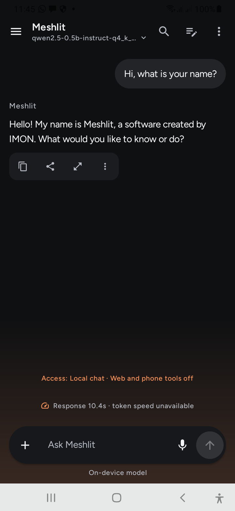
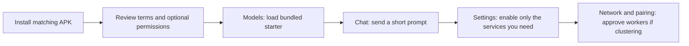
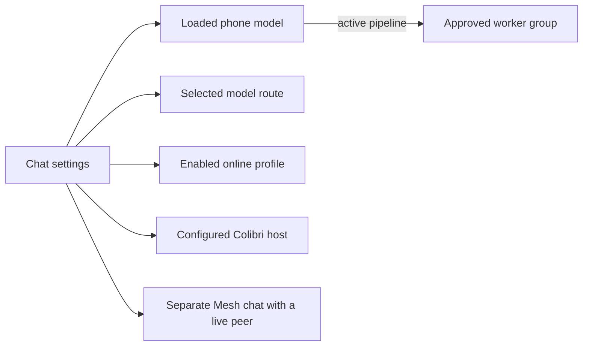
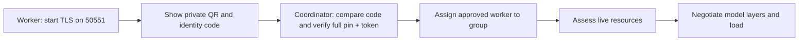
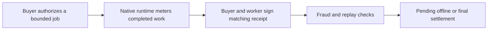

# Meshlit full app guide and configuration tutorial
<!-- meshlit-document-tracking:start -->
Tracking reconciled 2026-10-12: [Plan](../PLAN.md) · [Progress](../PROGRESS.md) · [Document status](DOCUMENTATION_STATUS.md).
Scope: Android/shared reference; desktop ports have separate acceptance. Phase labels in older sections retain their original scope.
<!-- meshlit-document-tracking:end -->

Updated 2026-10-23 for the experimental build 42 source. The Chat reply below was captured on Samsung build 42; the other phone captures are build 41 or earlier. The app packages an offline version under Settings → Guide and tutorial. Reading progress is not execution evidence.

## Start here: what Meshlit does

Meshlit is a phone-first private AI workspace. Run a supported local model on one device; manage files, chats and tasks; explicitly connect providers and owner-approved devices when needed. Android is the working on-device target. Experimental desktop and native HarmonyOS NEXT clients are described in docs/MULTIPLATFORM_NEXT.md; NEXT local inference and HAP/device acceptance remain unavailable/unverified. A model catalog, device role claim or installed library does not establish usable inference or training.

The drawer starts with four shortcuts: Models, Devices, Agents and Device management. Expand a category for other pages, or use its single search field. You can change the shortcuts under Customize menu. Devices contains discovery, the device list, pairing, saved QRs and approvals. Networking contains transport, relay and firewall controls. Settings opens on six essential destinations; Browse all shows the complete Basic list. Advanced lists optional tools and integrations. Search checks both lists and matches every entered word across names, descriptions and keywords, regardless of the selected tab.

Implementation status matters. Desktop layer workers have real execution evidence. Oversized-model execution across physical phones, replicated task/session failover and portable distributed KV recovery remain acceptance/implementation gates. This guide explains actual controls and labels future work explicitly. It contains no simulated devices, costs or performance charts.

## Visual map and installation

The first Chat and Settings captures below are from build 41 running on a Xiaomi M2101K7AI (Android 12). The second Chat capture shows a real Qwen2.5 0.5B answer on Samsung SM-A207F running build 42. The Models capture is from an earlier Android preview. These do not prove a physical layer cluster.

**Chat:** the model name is at the top, and the composer is at the bottom. The **+** menu opens files and chat options.

**Local model check:** Samsung answered “Hi, what is your name?” with its Meshlit identity. This single reply checks model loading and one prompt, not overall model accuracy. The runtime did not report a trustworthy token count, so the speed indicator remained unavailable.

**Models:** the library card, import action and bundled starter live here. The card's **Loaded** state means this capture's runtime accepted the model; your device must report its own state.

**Settings:** search for a named control. Switch to **Advanced** for network, cluster, agent and runtime controls. A result marked unavailable needs its stated backend or permission; a menu entry alone does not activate it.

For the GitHub experimental Android release, install the APK matching your device's ABI. The ARM64 split is intended for modern ARM64 phones and includes the native layer server and worker; the universal APK is larger and also contains those ARM64 executables. V1 and V2 debug flavors have separate app IDs and data. A newer build can update the same flavor only when its signing certificate matches. Keep the previous APK and a backup of identity/receipts before replacing an installation. Android may ask you to approve this file's install source. The GitHub beta is debug-signed; it is not a Google Play production release. The Play Review package is a separate restricted candidate.

## Language, appearance and platform previews

Android Settings → Appearance now offers English (default) and 简体中文. Chinese
covers the modern chat and model-library resource strings; advanced tools retain
English. Model answers, prompts, memory, inference settings and operation grants
are unchanged. Monochrome adds a quiet graphite/pearl palette while retaining font
size and accessibility. Existing custom appearance is never silently reset.

Intel Studio 40.1 bundles Qwen2.5 1.5B Q4_K_M, a private Java runtime and an owned CPU engine. Use either the DMG or PKG; both contain the same application. No extra JDK or Ollama installation is needed for its starter. In Chat choose local mode, Load or Send, then Stop/Unload when needed. Settings → Inference engine controls context, generation/prompt threads, batching, f16/q8_0 key cache, CPU selection and idle unloading. Auto selects AVX2 only after verified CPU and OS support; SSE4.2 remains available. q4_0 key cache is held out after a poor arithmetic test; it is different from Q4_K_M model weights.

Settings opens seven management categories. Basic and Advanced menus differ; typed search also finds advanced/pending destinations. Global search includes settings/features, current chat and saved model/node references, with separate settings/chat scopes. Web search is an explicit browser handoff, not automatic article retrieval. Models and downloads records validated GGUF imports; Discover models uses optional Hugging Face metadata and a bounded revision/hash-pinned single-file download. Desktop download resume and paid/gated entitlement verification remain pending.

The local monitor samples actual CPU/RAM/processes with charts/history. The human terminal is a bounded batch shell, not an embedded interactive PTY. SSH includes pinned outbound exec, a public-key status-only inbound node and optional external Ghostty handoff. HyperL CPU execution needs its separate terms. Saved node/API addresses are not enrolled layer workers; no desktop RPC controller or full automatic recovery is delivered by these menus. Android agent/MCP/A2A, voice/memory, cloud vault, firewall, VM/container and recovery screens are separate ports, labelled pending.

Studio's **Devices** shortcut opens a dashboard of saved phone/desktop/cluster addresses and the last successful check. “Previously reached” does not mean online now. Use **Manage and test** to enter a trusted HTTPS endpoint and a session-only client key. **Resources** shows the local computer's measured load; **Security & privacy** shows current host access and can revoke it, clear the session key and stop the active request. The command-line host client also supports `--status` for a machine-readable local capability report on desktop, server or container hosts. This is an operator status command, not a server or worker runtime. Studio discovery, group chat, native layer sharding, agents, MCP and Hooks remain pending where marked in the menu.

Compatible remote hosts require explicit access and their exact endpoint/token. Prompts go to that selected host; only literal loopback may use HTTP. Desktop chats/provider credentials are session-only; appearance, engine options, imported model references and saved node labels/addresses persist. Reported token usage stays unknown when unavailable. Both Intel installer launchers pass recovered-payload checks, but clean-machine installation, signing/notarization and other platforms remain separate gates. See [desktop install guide](MACOS_OFFLINE.md) and [feature tracker](DESKTOP_FEATURE_TRACKER.md).

HarmonyOS NEXT has a separate native ArkTS/ArkUI 26.0.0 source target, with English
as default, 简体中文, persisted appearance, bounded complete-response HTTPS chat and
a native capability adapter reporting local LLM inference unavailable. This is
not an Android APK. No DevEco/NDK/HAP/device test has passed here. Advanced Android
services, agents, SSH/VM and federation are not automatically available in the new
clients. See docs/MULTIPLATFORM_NEXT.md for setup and qualification gates.

## First-run walkthrough

1. Review optional setup permissions. Grant camera only for camera/QR work, microphone for voice, nearby/location permissions for supported discovery, notifications for ongoing work and Storage Access Framework grants for selected files/folders. Accessibility is a separate explicit opt-in. You can decline optional permissions and request them later.

2. Open Device, Power and Acceleration. Check the reported OS, ABI, memory, available storage and runtime availability. Start with a short context and smaller quantized model on constrained hardware. Unknown hardware metrics remain unknown.

3. Open Models and use the bundled Qwen2.5 0.5B Instruct Q4_K_M starter. The pinned artifact is 491,400,032 bytes (about 469 MiB), not an empty download placeholder. Select Load, generate a short prompt, stop if necessary and unload. Confirm the real model/runtime before enabling remembered boot loading.

4. Start a new chat, choose its model and generation options, then send a short task. Review outputs. A small starter model is useful for installation checks, not a guarantee of strong coding, agent planning or vision quality.

5. Open Appearance to choose comfortable fonts/text size and colors. Then read the pairing and cloud chapters before enabling external communications or delegation. Tutorial checkboxes mark lessons read; they do not certify that a feature passed on your device.

## Local models, downloads and import

Models is the dedicated management section. Bundled means the real artifact is packaged; Installed means a validated local file exists. Loaded means the active runtime accepted the model. Do not treat download progress alone as installation or generation proof.

Use the RunAnywhere download path for compatible SDK artifacts, verified HTTPS downloads for selected direct artifacts, or multi-file import through the Android document picker. HTTPS downloads use validation and atomic installation; expected hashes and pinned Hub revisions give stronger provenance than a mutable filename.

For Hugging Face, open **Hugging Face dashboard** in Advanced settings or Cloud management. Public Hub search works without a login. You can verify and save a personal access token in this device's encrypted model credential store, then use the existing GGUF search/download controls. Hosted inference has a separately configured inference token and explicit enable switch. Select the repository/file/revision and use a token only when access requires it. A public catalog can be browsed without entitlement to gated weights or hosted inference. Token verification does not establish paid balance, gated-model approval or license acceptance. Never paste tokens into chat or untrusted URLs.

Device admission considers usable RAM, storage, OS/ABI and policy. Do not add together nominal phone RAM and assume all of it is available to weights. The model also needs graph/workspace and KV memory. If loading fails, inspect real logs, file size/hash, supported architecture/quantization, memory budget and backend availability before retrying.

Select a startup model only after a successful load/generate/unload check. Remembered startup loading should report actual status and failure. Importing safetensors, PT/PTH or ONNX as a file does not make every format executable in the GGUF/llama backend; conversion and backend compatibility are separate.

## Context, quantization, KV and acceleration

Weight quantization belongs to the model artifact. Selecting a smaller context does not quantize its weights. Native-local context and key-cache precision are independent controls. Native CPU supports the packaged options; reload after changing runtime settings. Q8/Q4 key cache is different from model Q4_K_M weight quantization.

Context consumes memory and changes how much history/input can fit. Keep response token limits within the loaded context and the device plan. A larger context can reduce the memory left for weights. Use actual native-reported context rather than assuming an SDK preference was applied.

RunAnywhere SDK-managed controls that cannot be verified stay explicit/unknown. Streamed text chunks are not tokens. SDK usage currently stays null when its terminal counters lack reliable provenance. Standalone native results use actual reported prompt/generated counts and timings; reused prompt tokens use timings.cache_n, not final slot occupancy.

Acceleration settings report installed backend capability. A vendor name, GPU descriptor or future configuration reserve does not prove CUDA, Metal, ROCm, Vulkan, OpenCL, QNN, CANN or NPU execution. Current phone pipeline/native checkpoint acceptance is CPU-based. Unsupported adapters must remain unavailable.

## Choosing a model for this device

First-run empty Chat offers **See recommendations**. You can dismiss it and reopen recommendations from **Models** at any time. **Best fit** uses total/available RAM, storage, CPU architecture/core count, Android version, installed backend and heat; **Save storage** prioritizes the smallest viable option. Advice refreshes while the screen is open. A cool, roomy device may receive a different suggestion from a low-RAM or busy device of the same brand.

Qwen3 0.6B Q4 is about 378 MiB to download; Qwen3 1.7B and Qwen2.5 1.5B Q4 are about 1.0 GiB; Qwen3 4B Q4 is about 2.3 GiB. The panel shows separate storage reserve and model-memory estimates. These are candidates, not measured speed/accuracy promises. Tap **Download**, wait for checksum verification, then **Load installed model**. Downloading does not change your active/startup model or remove the starter. Qwen3's RunAnywhere chat path defaults to fast responses; append `/think` to request a reasoning turn or `/no_think` for a fast response. Long reasoning may hit the chat output ceiling. All these options are text models; they do not add image or speech support.

## Chat, routing and online models

Open the top-right chat menu to **Export full conversation** as JSON through Android's document picker. The file contains every stored message and this chat's options; choose a private location if its text or instructions are sensitive. **Delete this chat** asks for confirmation. The recent-chat drawer also lets you delete a selected conversation; deleting removes that local chat and its messages.

In Chat, tap **+** to choose files, select a photo, or take one. Small supported UTF-8 text/JSON/XML/code files enter the draft; unsupported binary types show a clear error. A selected photo appears with a preview and a **provider/model selector**. Type your question in the normal message box, then tap the usual **Send** arrow. A blank question requests a description. The photo goes to the displayed provider and its answer is saved directly in this conversation; a second local text model is not required. The provider's model must support images. If no profile is configured, tap **Set up a vision model**; Send stays disabled. **Stop** cancels the request, while errors leave the photo available to retry. Original images are not saved in history; source/model attribution and reported token usage are. The bundled Qwen model reads text only. Local VLM, PDF/Office and arbitrary binary chat readers remain pending.

Chats retain conversation history and selected options. “On-device model” describes where inference executes; it does not turn off internet access. Use a local model, a deliberately selected online profile or a configured scenario route. A local failure does not silently trigger a paid cloud request. Consumer chat subscriptions are different from provider API accounts.

**RAG and tuning status:** Settings → Fine-tuning can submit and monitor a real text LoRA job on an owner-installed Linux/macOS Soup training companion over a pinned SSH connection. The base is a Transformers safetensors snapshot and the dataset is real JSONL on that host. Android autograd, local phone training, distributed phone training and direct adapter loading are unavailable; completed adapters need host-side evaluation and GGUF export before import. Saved local content search and personal memory can inform on-device chat with their separate grants. The new Knowledge library supplies encrypted durable text retrieval under separate local/remote/agent grants. The older vector store remains in-memory. Its remote adapter now requires an explicit HTTPS bridge and credential reference; the default app wiring supplies no endpoint, so remote vector RAG remains unavailable until configured and qualified. A loaded model, model route or layer cluster does not automatically gain training or RAG.

**Device audit:** Settings → Audit and telemetry → Run device audit makes a fresh, redacted JSON report of Android-exposed hardware, current Meshlit resources, permission state and mesh activity. Use Export JSON to save that exact snapshot. Agents can call `device_audit_report` only after the separate AUDIT delegation in Agents. This report does not inspect other apps, payment/passkey state, private messages, active use of another app's sensors or the online status of saved peer addresses.

**Tune the companion:** Open Chat → Conversation settings → Companion personality. Choose Warm, Direct, Thoughtful, Playful or Custom, then set Neutral/Natural/Warm tone. Add your own instructions below. These choices are saved per conversation and passed to the selected local model, online provider, route or Colibri host. They change tone and framing, not model ability or tool grants. The single **18+ topics preference** switch is off by default; when on, it requests more open discussion of mature topics. Model and provider limits still apply, and the switch is not age verification. The bundled 0.5B starter remains a small model; use a more capable compatible model for longer, more reliable conversation.

Open **Chat → ⋮ → Conversation and token settings** to choose **Local**, an enabled **Online** profile, an automatic or named **Model route**, or a configured **Colibri host**. Local uses the currently loaded phone model, including an active approved layer cluster. The cluster controls show its active group and worker count. You can choose a saved worker group for the *next* cluster load, open **Manage cluster**, or **Remove cluster from chat**. Removing the cluster stops the pipeline and unloads that model; load a phone model in Models before chatting locally again. Group changes are blocked while a cluster is active. Selecting a route or online profile sends the conversation according to that profile's own permissions and availability; it does not join a peer chat.

**Mesh chat** in the drawer is a separate, foreground, one-peer text channel over an actually connected WebRTC path. Both sides enable P2P, manually exchange signed pairing information and approve the connection. A local agent may read/send only with saved grants and the chat's separate peer-tool switch. Incoming peer text is untrusted content. The channel confirms local queueing, not remote delivery. It does not yet provide multi-member rooms, persisted conversation history or offline message delivery; the membership relay does not carry these chat messages. Use **Network and pairing → Host relay / Join cluster** for membership, and **Mesh chat** for the separate live direct conversation.

For experimental local tools, open **+ → Chat options and model routing** and separately enable **Allow web page tools** or **Allow phone tools**. Both default off. Web-page retrieval needs your configured HTTPS Crawl4AI companion and domain approval; no crawler or search account is created automatically. Phone tools need saved autonomy, app scope and Android Accessibility. The loop allows up to eight actions within five minutes when phone tools are selected, or three calls within 180 seconds otherwise; it rejects invalid model plans. The bundled Qwen2.5 0.5B starter is not qualified for reliable tool use. See [local tool setup and limits](LOCAL_MODEL_TOOLS.md).

**Built-in phone agent:** load a local model, open Settings → Phone agent and autonomy, enable autonomous delegation, add an installed browser to app scope and save it, then enable Meshlit Accessibility in Android settings. In the same Chat conversation, turn on Allow phone tools and ask for a task. This uses the phone model and the phone's Accessibility service; the optional OpenClaw gateway is not required. Chat shows each planning/action step and Stop cancels the run. Check the actual target app before trusting a completion message. The bundled starter model has not passed a Chrome/YouTube planning test; import a stronger compatible local model for experimental multi-step tasks if the phone has enough memory. More detail: [built-in agent design and acceptance](BUILT_IN_AGENT_DESIGN.md).

In Settings → Agent management, create an agent assigned to the currently loaded local model and enable it. Chat → Conversation settings lists enabled local profiles; selecting one copies its instructions into that conversation. Then choose the tools that conversation may request. The Agent management **Run task** button runs a text generation job only, so use Chat for phone or web tool actions.

The same chat can enable multi-node commands, GibberLink and other tool groups together while the combined list stays at or below ten tools. The settings screen shows the count and Save rejects an oversized combination. Each tool still checks its own saved permission and the receiving device's approval; enabling a switch alone does not authorize execution. Remote/online model routes do not currently host these on-device tools.

Online providers support existing protocol adapters such as OpenAI/compatible, Anthropic and Gemini. Save API credentials encrypted, configure the actual endpoint/model and discover supported models when the provider offers discovery. Select whether the profile allows agents; do not assume every model accepts temperature or all modalities.

Online profiles can reference an API vault environment and variable name. The environment must match the endpoint origin and remain unexpired. A reference overrides a legacy saved key. Agent requests need both profile and environment approval; changing the API endpoint cannot redirect that bound secret.

Model router recipes can select by scenario, run sequential model chains or compare answers. Review the actual steps, model availability, instructions and agent policy. Sequential chaining/job distribution is not splitting transformer layers. Cloud usage-based estimates require reported tokens and known rates; missing data is unknown.

You may save several installed local models and configure up to three steps in a route, then select that route in Chat. On Android today, the text runtime holds one active local model session. A route loads local steps one after another, which can incur model swap time. It cannot keep several local LLMs resident for simultaneous inference or silently combine their RAM. A future multi-model pool needs independent runtime sessions and explicit RAM/KV/thermal admission before offering concurrent routing.

Use attachment/media options appropriate to the selected backend. Text file input, vision, image generation, speech or video are separate adapters; attaching a file is not proof that the model can perceive or generate its modality. The chat menu exports the selected conversation as JSON.

The compact chat layout centers the welcome message and anchors a rounded composer above the keyboard. Welcome text and the secondary caption hide while typing. The plus menu opens text files, photo/camera input, media generation and chat options. Reply Copy and Share use the clipboard and a human-initiated Android chooser. Generated media has Save and Share controls. Photo questions use the same message box and Send/Stop controls. The attachment names the selected provider/model and sharing destination; changing it never uploads the photo. The compact mobile dock links Chat, Models, Devices, Agents and Settings; it hides while the keyboard is open. Voice opens an inline panel with manual Start live / End conversation, mute, tap interruption and optional phrase captions. Detailed voice choices stay under the tune icon.

## Files, AI assets and ZIP / unzip

Files keeps the existing granted-storage browser and adds AI file inspection plus ZIP tools. Browse/copy/move/share/delete only within app/user-authorized storage. Android document providers control permission, available space and remote quotas. Removing a grant can invalidate a stored URI.

The AI file toolkit recognizes workflows for GGUF weights; safetensors/bin/PT/PTH/ONNX; tokenizer JSON/vocab/SentencePiece; LoRA adapters; JSONL/CSV/Parquet datasets; Markdown/PDF documents; source/configuration files; images, audio and video. Binary files are handled as files; they are not executed or rendered as text. Text preview is limited to 16 KiB and explicitly truncated.

To create ZIP: select multiple files, set the input byte limit, choose a new output ZIP document and start. To extract: select a ZIP, choose a writable output folder, set the expanded byte limit and extract into the new uniquely named folder. Keep the screen open; leaving it cancels its current foreground operation.

ZIP uses 64 KiB streaming buffers and real byte/file counters. Limits include 10,000 entries, depth 16 and a configurable 1–128 GiB input/expanded budget. Extraction rejects absolute/drive/traversal/ambiguous paths and duplicates, creates ordinary files and avoids overwrite. CRC errors, cancellation and provider failures stop the operation; partial outputs are removed where possible and cleanup failures are shown.

Encrypted ZIP, RAR, 7z, multi-volume archives and restoration of links/Unix permissions are unsupported. A very large ZIP64/provider combination still needs physical-device acceptance. Unpack model bundles before importing compatible weights through Models; archive extraction does not authorize scripts or install a runtime.

## Phone clusters, mixed devices and pairing

Phones are the primary compute target. Other nodes may contribute compute, storage, tools, routing, monitoring, sensors, actuation or media/preprocessing according to actual installed capability. Raspberry Pi/MCU/ESP32/Arduino participation does not imply transformer execution. A router/switch/firewall descriptor is not an inference backend.

Use **Devices** for discovery, the compact device list, manual/QR enrollment, fingerprint verification, approvals and saved device management. Use **Networking** for transport, relay and firewall controls. Independently verify identity before approval. Choose minimal scopes/roles. Enrolled web/API/SSH devices and native layer workers are distinct memberships; one approval does not automatically grant the other.

**Choose a connection path:** In **Networking**, choose **Direct device pairing · local or Internet** for another Meshlit device, with a QR or identity-pinned HTTPS endpoint when it is remote. **Open Android VPN settings** opens the phone's VPN configuration; Meshlit does not provision a VPN. Choose **Join or host a relay cluster** for membership via a reachable local, VPN or Internet address. **Web/API devices and groups** enrolls a browser or API control client; that is not a native compute worker. On the host's **Host relay** page, a new six-digit join code has a visible ten-minute countdown and rotates automatically at expiry. Copy an invite while the code is valid; an older code cannot admit a new member.

**Add a nearby phone:** Leave Meshlit open on both phones and connect them to the same local network. Open **Devices** from the drawer; discovery starts automatically by default. Tap **Browse device list** for a compact inventory with search, local/cluster/VPN/remote filters, claimed name, manufacturer/model, address and discovery status. Tap a row to inspect its claimed ID and fingerprint. This list shows Meshlit advertisements, not every device on the LAN, and “Discovered” is not proof of identity or reachability. Back on Devices, nearby Meshlit devices show an **Add** button; saved devices show Saved. Opening Devices starts this phone's identity endpoint while the app is foregrounded. Tap Add, review the address and ID, then choose **Save for later** or, when the owner's QR supplies a public identity key, **Verify & connect now**. The latter checks identity and waits for the other owner to approve compute. **Reject device** discards the candidate. Saved unverified devices can be verified later with **Pair securely**. In **This device · share to pair**, use **Copy ID**, **Copy endpoint**, or **Copy pairing link** to transfer exact values. **QR / paste** has a full-width pairing-link box below the camera and image controls, plus reusable and refreshed five-minute QR options. If no phone appears, confirm both apps are open, local discovery is enabled in Security & privacy, and the network permits devices to contact each other.

The **Pairing radar** on Devices shows current network discoveries as moving rings and dots. Saved devices remain in the separate list below. Green means locally approved with a matching advertised key, and red means unverified. Tap a live dot to open its identity review, or tap **Refresh nearby scan** to retry discovery. Dots without measured direction or range sit in a labeled unknown-position strip; the rings do not measure physical distance.

**Read a QR:** In **Devices → QR / paste**, tap **Scan QR with camera** for a live in-app camera reader and aim at the *other* device's displayed QR. Grant the camera permission when Android asks. If you already have a screenshot, tap **Choose QR image**; for a picture in another camera app, tap **Take QR photo**. A valid Meshlit pairing code opens a review with **Verify & connect now**, **Save for later**, and **Reject device** before any trust decision. Other QR codes show their decoded contents with a copy button; they do not pair a device. On Xiaomi or another phone whose camera app returns a cancellation result after saving a photo, the app also checks whether the image file was written. To keep a code, tap **Save this QR in Device management** on your own QR, or save a received QR during review. Use **Save QR image to device** to choose a folder and export a PNG. Open **Devices → Saved QRs and device management** (also in Settings) to see reusable and temporary codes separately; use **View**, **Share**, **Save PNG**, or **Delete**. An expired temporary copy cannot be shared as a fresh code. Saving or sharing a code does not approve compute access.

**Studio device and QR inventory:** In **Studio → Devices**, search saved endpoints by name, type or address and filter them by saved category. Studio does not currently perform a live subnet scan or report real-time remote status from that list. Paste a Meshlit pairing link or choose a PNG/JPEG QR image. Studio reads the code, separates reusable and temporary entries, and lets you copy the link, export a PNG, or delete the saved copy. Studio's QR inventory is for exchange and review; it does not enroll a native layer worker or verify a phone's live identity by itself.

**Device notifications and multiple pairing requests:** The **Notifications** button at the top of **Devices** shows the number of new events or waiting requests. Open it for recent pairing activity, then tap **Manage requests & history** to approve or reject a waiting request. This marks recorded events as read; waiting requests remain visible until handled. **Devices → Saved QRs and device management → Pairing inbox** lists requests in arrival order with each device ID, fingerprint and requested tier. Up to 64 distinct requests can wait simultaneously; new requests receive an explicit retry-later response if the inbox is full. Approving one does not end another active session. Requests expire after five minutes unless the peer sends a fresh signed request. **Pairing history** retains the 100 most recent local events, including outgoing attempts, and links back to Devices for a fresh reconnect request. **Pairing notifications** controls rate-limited Android alerts for new waiting requests and verified connections or renewals; Android notification permission still applies. Approval always remains a separate action. To remove access, revoke the device in Device management, which revokes its local trust policy and active session tokens.

For native layers, start the worker, enter its reachable LAN, hotspot or configured virtual-network address, and show its private QR. On the coordinator, select a group, scan or enter the full certificate hash and token, compare the short identity code shown on both devices, then verify and approve. The code is a visual check, not a password or discovery service. An offline local network needs no internet. Internet workers currently need a VPN or reachable TCP endpoint; the built-in membership relay does not transport model layers. Assess workers to view live offered resources and the heuristic operational risk score before loading. The score is not a measured speed or security guarantee.

1. On **each worker**, open **Network and pairing → Layer pipeline**. Confirm the native runtime is packaged, permit inbound TCP **50551** in Network rules for the intended peers, then tap **Start worker**.
2. In **Reachable host**, enter the address that the coordinator can actually reach. Use a LAN/hotspot IP for an air-gapped group, a preconfigured VPN/virtual-network IP, or a reachable DNS name. Tap **Show pairing QR**. The QR contains a private token; show it only to the coordinator owner.
3. On the **coordinator**, open the same Layer pipeline panel, create or select a **Cluster group**, then use **Scan worker QR**. If scanning is unavailable, choose **Add approved worker** and enter the worker's address, full SHA-256 certificate fingerprint and token.
4. Compare the **Identity check code** displayed on the worker and approval screen, then tap **Verify and approve**. Approval contacts the running worker and rejects an incorrect TLS pin, token, revision or permission. Repeat for at least two distinct workers in the group.
5. Tap **Assess workers**. Read the device class, available memory/storage, thermal state, control RTT and admission warning. Select an installed GGUF, then **Negotiate and load cluster**. The coordinator keeps the whole model file and assigns layers by live memory headroom. Use **Stop pipeline** before changing groups.
6. If a QR/token is exposed, stop the worker and tap **Rotate pairing token**, then reapprove it on coordinators. A worker behind NAT cannot use the built-in membership relay for layers yet. A virtual network must be configured outside Meshlit; this control does not create a VLAN or VPN.

Native worker traffic uses authenticated pinned TLS, with private native sockets. The corrected Android TLS identity changes the fingerprint; previously paired workers/control endpoints need independent verification and explicit reapproval. The persisted listener firewall must permit the actual port; default denial is not a handshake success.

Capability offers are freshness/compatibility/thermal/memory checked. Placement budgets include weights, context-dependent KV and workspace margins. Election/placement remain advisory until fenced consensus exists. Do not call the current planner automatic master failover.

Physical acceptance requires at least two compatible phones, a model larger than one phone can hold, observed layer allocations, correct tokens, memory/latency/thermal readings and cancellation/loss/reconnect results. Desktop workers and a single emulator cannot replace that evidence.

## Mesh identity, rewards and purchases

In Android **Settings → Mesh rewards wallet** or **Network and pairing → Open rewards wallet**, use **Opt in to local receipts** only if you want signed records for qualifying completed hosted inference. Turning it off stops new records. **Contribution measurements and proof** separates durable receipt totals from live counters that reset on restart, and marks energy, bytes, requester confirmation and monetary value unavailable. The local balance sums reported native generated tokens; personal chat, unknown token usage, forwarded work, cancellation and failure earn none. **Back up receipts** exports the history; **Restore receipts** requires the same wallet identity and a matching prefix. No proofs or logs are automatically uploaded. A future monetary program needs an additional opt-in to share redacted job proofs with named verifiers, independent confirmation and dispute rules. This local balance is not cash, a transferable coin or proof that another party received service.

Studio **Mesh identity & rewards** can create or unlock its encrypted local identity, export an encrypted backup and review signed receipts. Studio hosting is not connected to earning yet. Its personal chat earns nothing. The [reward metering and settlement plan](REWARD_METERING_AND_SETTLEMENT.md) separates future measured inference, compute, storage and relay services from purchases, rentals and payouts. No monetary exchange is enabled in this build.

The last diagram is a **future settlement design**, not an implemented payment workflow. A worker's self-signed record alone cannot mint spendable value.

## Recovery and memory holders

Native CPU checkpoint workflow: load native-local with a real model and selected context/key-cache precision; generate; save the completed cache in Checkpoints and recovery; stop/reload the identical model/settings; select Restore. Confirm actual native save/restore token/byte counts.

Snapshots are AES-256-GCM encrypted on this app installation, synchronously indexed after atomic blob writing and bounded to 16 snapshots, 128 MiB each and 256 MiB total. Model and executable hashes, context and cache precision must match. Corruption and incompatibility fail closed. Plaintext staging is temporary and removed.

Restored KV is not conversation history or task completion. It can reuse compatible prompt prefixes. Copying the ciphertext to another phone cannot decrypt it there. Distributed recipient key wrapping, durable artifact holders and portable/RPC KV compatibility remain future protocol work.

Task/session replication, majority commits, fenced ownership, leases, coordinator failover and crash recovery are not implemented by local snapshots. The planned design replicates compact journals across consenting phones and keeps large model/checkpoint objects on selected holders. Three durable replicas are needed for a one-failure majority design; five for two. Actual network-partition and no-quorum behavior must be tested.

## Tasks, agents and human controls

Task manager supports planning, task/subtask organization, priorities/tags/dates, real job links and bulk state changes. Metadata changes do not execute a task. Typed jobs expose queued/running/succeeded/failed/cancelled/interrupted phases and stable request IDs; restart does not silently repeat uncertain external actions.

To stop one running job, open **Task manager → Operations** and tap **Stop** on its row. Use **Select active → Stop selected** for several. This requests local cancellation; it cannot reverse a completed provider charge or remote command. Active jobs have no safe pause/resume checkpoint, so the dashboard labels pause unavailable and Retry creates a new attempt. For an immediate instance-wide stop, tap **Whole-app emergency stop** to open Operations, then **Emergency stop all managed operations**. That also closes supported delegated sessions but is local to this device.

Human and agent control are separate. Configure saved delegation per scope, then per-provider/host/device/environment controls where applicable. Credential/policy edits remain human-only. Root remains human-only; VM activation and Android autonomy require their own saved opt-ins.

**Create an agent:** Open **Agents** from the drawer, select a currently loaded local model or a saved agent-approved online profile, name the agent and add an optional instruction. New profiles start disabled. Enable a profile, enter a task and run it as a typed model-generation job; the same screen can launch several selected profiles in parallel. A profile is a job template, not an independent background daemon. Its model scope still needs the separate global delegation, and it contains no device, tool or credential grant. Disable or delete the profile to stop future launches; cancel an already running job in Task manager.

**Inspect agents and MCP:** Advanced settings → Agent registry lists saved agent profiles and currently registered tools. Agent logs is a separate filtered view of local agent events. MCP connections suggests common external server types and lets an owner enroll an already running exact HTTPS route with a bearer token and explicit tool allowlist. Suggestions do not install servers. New routes have no tool access until names are entered, and agent calls need their separate switch and gateway controls. Use Agent Gateway to restart and refresh after route changes. These controls do not make an external MCP server trustworthy; inspect its own permissions and outputs.

Agents should call typed commands and inspect observable results rather than depend on UI coordinates. A successful job result must identify what happened; unsupported features return unavailable/blocked states. Revocation is checked at supported boundaries; cancellation cannot undo completed remote actions.

OpenClaw can connect to an explicitly configured gateway and optionally use the loopback phone-model provider. Pairing, signed node capabilities, permissions and Accessibility app allowlists are separate. Live gateway and physical consent/stop/revoke acceptance remain necessary.

**Emergency stop:** Operations → Emergency stop latches a whole-app pause for supported delegated work. It disables Android automation, disconnects the OpenClaw node, stops the web bridge and phone-model sharing, and closes the agent gateway. Review Task manager for unfinished work and independently check any remote service that may already have acted. Resume is a human operation; existing remote effects cannot be undone by this switch.

In Browser, load a compatible on-device model, open an HTTPS site, enter a task and expand Autonomy settings. Enable this origin, choose Follow same-origin links and/or Fill ordinary text fields, select 1–20 actions and Run autonomously. Sessions stop after 120 seconds, Stop, backgrounding, permission revocation, page changes or invalid model JSON. Agents additionally need Allow delegated agents for the site and saved global/enrolled-device BROWSER scopes. BROWSER_STATUS, BROWSER_AUTONOMOUS_RUN and BROWSER_STOP are typed commands. Autonomous navigation follows normal links without site click handlers; action buttons/form submissions, login/CAPTCHA/MFA, payments and destructive actions require human review. Ordinary text filling does not fire input/change events, so complex widgets may need manual steps. This operates Meshlit’s visible WebView; external Chrome/Samsung Internet can use the existing Android Accessibility tools: in Phone agent and autonomy add an actually detected browser to app scope, save it, explicitly enable delegation and grant Accessibility in Android settings. Agents then use android_control open/snapshot/click/type/back. This generic UI path needs physical testing and is separate from the bounded WebView DOM loop. The starter is not a proven browser planner. Do not confuse source/DOM tests with a successful real-site model task.

## Cloud: resources, costs and provider configuration

Cloud and credentials has Dashboard, Providers, Credentials and Agent settings. First create a named CLOUD/API environment with the documented variable names; configure a vendor/profile; enable intended human actions; explicitly refresh an identity/resource response. Missing accounts produce no fake connected resource cards.

The dashboard's **Cost metric coverage** card identifies which values can currently be refreshed. It shows AWS month-to-date Cost Explorer, Azure ActualCost, DigitalOcean balance/usage and OpenRouter key usage when a matching read action succeeds. GCP currently reports billing association, not spend. Hugging Face and custom adapters have no normalized live spend. Additional providers can be enrolled as a scoped read-only custom HTTPS API for raw responses, but those responses are not summed into the cost dashboard. Cloudflare, Oracle Cloud, Alibaba Cloud, Hetzner and other native cost adapters remain pending. Cost data is provider-scoped, may be delayed or partial and is never a verified invoice.

AWS adapters cover STS identity, EC2 instance inventory and month-to-date UnblendedCost through yesterday UTC. Temporary ASIA credentials need a session token. Cost Explorer needs metered-read consent and the supported us-east-1 profile; first-day current-month data is unavailable. Azure covers subscriptions/resources and ActualCost query with an existing Entra token. DigitalOcean covers account/Droplets/GPU Droplets and balance. GCP covers projects/Compute and billing association; spend needs a future billing-export adapter.

OpenRouter offers actual key usage/limits and a public model catalog. Public catalog access can be unauthenticated; it does not grant model inference entitlement. Custom/other providers can define read-only function IDs mapped to fixed public HTTPS paths with bearer authentication. Generic arbitrary HTTP methods, private metadata targets and auto-followed redirects are unavailable.

The dashboard derives values only from vendor fields and shows source/fetch time, missing values, delay and partial/truncated results. It is not necessarily a final invoice. Human and agent action lists are independent; agents also need global CLOUD delegation, environment permission and per-device CLOUD approval.

Refresh cooldown defaults to 30 seconds; agent budget defaults to 20 calls per UTC day, committed before attempting the request. Failed admitted requests count. This limits requests, not guaranteed currency spending. No background metered refresh or automatic retry occurs. Broader vendor services, OAuth refresh, provisioning, budgets and deployment require their own adapters.

## Credentials, environments, API keys and login

Create a vault environment/profile, choose purpose, save named values and optional expiry, and set agent permission separately. Values are encrypted and never shown in public descriptions, chat, typed command arguments or log/configuration export. Rotate values by name; remove unused variables/profiles. Profiles referencing an environment must be reconfigured before deleting it.

API environments can be bound to the exact HTTPS service origin. Online models/media consume a selected variable internally; endpoint changes fail binding checks. SSH environments are bound to the exact host and use SSH_PASSWORD or SSH_PRIVATE_KEY alongside the separately verified host-key pin. Vault environment IDs are device-local and need explicit rebinding after configuration transfer.

For web login, save LOGIN_USERNAME and LOGIN_PASSWORD in a WEB_LOGIN profile bound to the exact HTTPS origin. In the visible browser, select Saved login credentials and confirm sharing. Filling requires a single visible top-level same-origin form and does not click Submit. Site scripts can read entered values. Cross-origin/iframe/ambiguous forms, MFA and CAPTCHA require a human.

Automatic credential export/sync, OS-wide autofill, OAuth refresh and unattended password entry remain unavailable. Android backup/transfer excludes preference/policy and native cache files because Keystore keys do not transfer. Re-enroll and enter credentials on a new installation; do not expect a copied encrypted preference file to work.

## Terraform / OpenTofu, Pulumi and Ansible

These tools fit Cloud automation. Terraform/OpenTofu manage state-backed resource provisioning with saved plans. Pulumi uses code-based desired state and Automation API preview/up/refresh. Ansible configures machines and deploys software through an approved inventory/control host. Their execution environments belong on an approved host with the required CLIs/plugins/language runtime, not implicitly inside Android.

The dedicated managed IaC adapter is planned, not implemented. Existing pinned SSH can execute operator-approved commands but its bounded command lifecycle is not a durable deployment manager. Use validate → saved plan/preview → review → approved apply → reconcile/status, with state locking/fencing and an immutable approved plan hash.

Future settings must separate human operation, agent validate/preview, agent apply and destructive operations; bind account/project/region/resource scopes; apply money budgets and approval policy; preserve encrypted state and sanitized logs. CLOUD read permission must not grant deployment or shell permission. Plans/state may contain secrets and cannot be dumped into Android job history.

Cancellation does not roll back completed changes. Ansible check mode depends on module support and is not a universal no-side-effects guarantee. Rollback needs a fresh reviewed recovery plan. Packer, cloud-init, Helm and Chinese-vendor adapters are capability-specific follow-ups after actual host/tool acceptance.

## SSH, terminal, Linux VM and IDE

SSH uses the open-source JSch implementation, independently verified SHA256 host-key fingerprints, encrypted password/private-key credentials and per-host agent opt-in. Commands are bounded to 60 seconds and 64 KiB stdout/stderr each. Cancellation disconnects the session, not already-completed remote work. PTY/SFTP and durable deployment are follow-ups.

Optional local terminal/Termux/runtime paths need actually installed binaries and Android permissions. The full VM stays off by default; a user or an opted-in agent can request compatible activation. Root, rootless and sandbox methods have different capabilities; no UI switch creates missing kernel/device support.

VM/VNC needs a real compatible guest/runtime and owner-approved display/network setup. A configured path or status label is not a booted guest or connected desktop. Keep administrative ports private/authenticated.

The code workspace is a bounded offline source editor with files, syntax highlighting/search and SHA write checks. Save before switching files. Build/debug/test toolchains require a real installed local/Linux/SSH host integration. It is not a full VS Code desktop runtime or compiler by default.

## Camera, vision, audio, radio and peripherals

Media options expose currently wired image/phone-camera-thumbnail and compatible voice/model paths. Camera permission does not imply live CCTV ingestion; microphone permission does not prove STT/TTS model compatibility. Hosted image/video/speech APIs require the appropriate provider adapter, account/model and explicit data sharing.

Tap the chat microphone to open the voice controls inside Chat; this does not begin recording. Choose **Live conversation** for repeated turns or **One turn**, then tap **Start live** or **Start one turn**. **Mute mic** cancels an active capture and waits for **Unmute**; it does not silence a reply already playing. **Interrupt** cancels transcription, thinking or speech and waits for cleanup before listening again. **End conversation** ends capture/playback and owned generation. Live mode is bounded to ten replies or five minutes. Silence causes Live mode to wait for another turn; One turn reports no speech. The status changes from Listening to Transcribing, Thinking and Speaking. The microphone/PCM meter uses measured audio; Android voices expose playback state only.

Open **Voice settings → Audio conversation captions** to show recognized speech and each spoken reply phrase. Captions are scrollable and are not word-aligned subtitles. Full replies remain in Chat. Voice settings persists recognition, voice and network choices. Offline input needs a verified Whisper pack or an Android service that guarantees on-device recognition. On Android 11, use an app-local offline pack. **Test recognition only** displays a transcript without sending it to the chat LLM; **Play real voice sample** checks output separately. Online speech needs an enabled compatible provider, **Allow network audio**, supported recognition/synthesis model IDs and credentials configured inside Meshlit. The selected provider receives microphone audio for transcription and reply text for synthesis. A configured profile is not a verified provider response. Automatic acoustic interruption and simultaneous full-duplex voice are not implemented.

External devices and OTG reports actual USB descriptors/classes, permissions and mounted/user-granted storage. A detected GPU/serial/camera descriptor does not install its driver or make it usable for inference. Hotplug and vendor hardware testing remain necessary.

CCTV/RTSP/UVC/live audio, MCU telemetry/actuation and radio/DSP adapters are future capability work. Two-way HF/VHF/microwave/cellular communication requires suitable owner-paired hardware, drivers and permitted operation; receive-only evidence is not transmit support. A phone alone cannot emit arbitrary radio bands.

Future Linux, Windows, macOS and HarmonyOS clients and NVIDIA/AMD/Intel/Huawei/Chinese vendor backends need independent runtime builds/tests. Mixed-node role claims must be tied to real capability and stop/revoke behavior, not invented throughput.

## Power, networking, firewall and pricing

Power and costs shows available battery/current/thermal/network readings plus policy and estimates. Whole-device power can be an estimate; missing sensors stay unknown. Transfer/new-load constraints, low battery/power-save and thermal state can limit work. They do not enable hardware bypass charging.

The coverage card distinguishes device readings from app/job energy attribution. Meshlit does not yet have a measured per-agent, per-model or per-peer energy and monetary ledger across the full app. Do not use a whole-phone battery estimate or cloud account total as a reward or worker bill.

Firewall settings control supported Meshlit listeners/connections, with persisted validated port/address rules. It is not an Android OS-wide packet firewall or arbitrary outbound interception. Verify the actual transport/port and separate enrollment from worker authorization.

Price snapshots record provider/source/fetch time. Refresh official live catalog data when supported and review the provider-specific pricing page for other models. Free/catalog/login/gated/API entitlement distinctions remain visible. Usage-based estimates exclude taxes, cache/tool discounts and unreported token types unless the source explicitly covers them.

Before using the cloud, set credential expiry, scopes, request limits and intended human/agent actions. Before using a cluster, confirm actual network reachability, independent pins and memory budget. Unknown readings should not be replaced with optimistic defaults.

## Appearance, accessibility and modern surfaces

Appearance persists light/dark/system/time mode, wallpaper dynamic colors (Android 12+), accent/base palette, animation choice and font size. UI font options are packaged Figtree, system sans, serif and Maple Mono. Code/metric styles can retain their explicit mono family.

Tinted glass is an optional translucent surface treatment over color-tinted backgrounds; it is not a claim of iOS Liquid Glass or live background blur. Solid surfaces remain the default. Low memory, power-save, severe thermal and high-contrast modes use solid surfaces and constrain animation.

Use the live text sample, keep important controls readable and test large text on your device. System font scaling is preserved in addition to the app font scale. High contrast prioritizes solid surfaces. Custom font-file import and arbitrary blur/background effects are future work.

The redesign does not mean every retained legacy screen is modernized. Guide/tutorial and new settings sections share the modern navigation. Real phone layout, touch/keyboard, contrast and scrolling still need inspection; emulator screenshots are distinct evidence.

Settings uses one toolbar; detail pages hide the main tab bar. Appearance has compact controls instead of a large banner. Fresh defaults use Sky accent and system light/dark with neutral surfaces. Existing saved choices remain. Reference blue selects light/Paper/Sky in one saved edit while preserving font and accessibility preferences. Models opens with import, downloads, search and models; device/startup policy and download access details expand on demand.

## Configuration transfer, logs and troubleshooting

Configuration profiles export/import bounded non-secret desired settings with preview/preflight and partial-apply reporting. Online templates import disabled and without agent permission; device-local vault references are removed. Credentials, trust/pairing, root/autonomy/delegation and distributed transactions are not transferred.

Logs can be searched, filtered by severity/source and exported as TXT/JSONL through supported flows. Review the timestamp/source/error, actual model path/hash and job phase. A task marked done in metadata is not proof that a remote action succeeded. Do not place secrets in user-authored scripts, prompts or labels.

If a model does not load: verify a complete artifact and hash, supported format/architecture, current backend/ABI, storage/RAM, context and policy; stop conflicting sessions; inspect failure logs. If download fails: check access/revision/HTTPS/space, pause/resume where supported and inspect install validation. Do not delete working data blindly.

If pairing fails: verify reachability, explicit firewall allowance, identity revision/pin/token and independent approvals. If cloud fails: check token expiry, IAM/RBAC/quota/region and service origin. If an archive fails: inspect byte/count/path/CRC/provider limits and partial-output cleanup. If recovery fails: verify exact model/runtime/context/cache identity and installation key.

Samsung USB authorization was restored on 2026-10-08 and single-phone testing resumed. See [dated device evidence](DEVICE_TESTING_2026-10-08.md) for individual outcomes; this does not establish two-phone cluster acceptance. Wireless debugging requires owner pairing on supported devices; it is distinct from an in-app ADB adapter. No live SSH host or cloud account is configured for these checks.

In **Settings → App permissions**, use Request for an ungranted optional feature or Manage to open Android settings, including for already granted permissions. Android 11 notifications have no runtime permission prompt. The Full build can open Android's installer for a human-selected APK, request exact-package removal, or open another app's permissions screen. These are human confirmation workflows; submitting a request does not verify completion. Silent/root/device-owner and in-app wireless ADB administration remain unimplemented.

## Settings directory and safe recipes

**Basic** contains everyday controls such as Appearance, Models, Device radar, Mesh chat, Resources and sensors, Network and pairing, Search, Logs, Guide, Privacy and About. **Advanced** contains optional integration and runtime controls including Sharding and workers, Local behavior and guardrails, agents, SSH, HyperL, remote commands, GibberLink, VM, crawler and hooks. Search checks both tabs. **Customize menu** adds, removes and reorders up to twelve shared shortcuts in Settings and the drawer; changes are saved locally. The menu does not change feature permissions.

The **Access** line above Chat's composer shows the saved local, online or host route and whether this conversation permits web and phone tool requests. Tap it for Conversation settings. A chat tool switch does not grant the model access by itself: the matching app, agent and device permissions must also be approved. The bundled Qwen2.5 0.5B model replaces the former 135M starter that fabricated an identity on Xiaomi, but it remains a small model and may still give inaccurate answers. For consequential answers, load a compatible larger local model in Models or choose a configured online provider, then review its network and cost permissions before sending.

**Device radar** shows current NSD/BLE discoveries as pulsing dots. Saved Meshlit devices and workers remain in separate lists and are never drawn as live targets. A QR import alone is not a current network discovery. Tap a live dot or **Add and review identity** to open the device's pairing review. Meshlit requests a signed identity proof, compares its key to the advertised fingerprint and shows the fingerprint for you to compare with the owner. You can then **Verify & connect now**, **Save for later** or **Reject**; the other owner's approval is still needed for compute. A moving sweep appears while discovery is active and animations are enabled. Numbered dots match the **Radar device table** below. When no measured direction and range are available, dots sit in a labeled unknown-position strip rather than implying a real bearing. The table shows claimed name, short ID, category, transport and address; CPU, memory, load and battery remain unknown until a verified resource exchange. **Refresh discovery** restarts the scan. Green means locally approved with a matching advertised key; red means unverified. An advertisement is not verified identity. The radar's read-only `device_radar_status` agent tool does not start scanning or grant trust.

**Non-Meshlit devices:** In **Networking → LAN and VPN services**, enter a local/VPN HTTP URL or a public HTTPS URL, choose a device category, then **Check and save**. The app sends a bounded HEAD request and records the actual HTTP status; this proves only that a service answered. Use **MCP connections** for a compatible tool server, **Online providers** for a compatible model API, or **SSH connections** for a host with an SSH server and independently verified host key. Each adapter has separate credentials and agent permissions. To let a browser or API client join this phone, open **Meshlit Web/API bridge**, start its TLS interface, create a 15-minute invitation, open the shown HTTPS address on the other device's browser, request enrollment and approve its access. The browser can optionally remember its token for seven days in that browser profile; use this only on a trusted device. The phone enforces expiration and revocation. Expired access needs a new invitation and owner approval. A Web/API client is a control client, not a native compute worker. The dashboard counts these external services separately from paired Meshlit devices.

**Global host map:** Open **Networking → Global host map** or **Device radar → Global host map**. The offline Leaflet map uses public-domain Natural Earth land geometry. Turn on **OpenStreetMap streets** only when you want online tiles; the viewed area and your IP reach OpenStreetMap's tile service. **Locate this phone on map** asks for a current location fix and centers a blue marker visible only on this phone. It does not turn on sharing. **Find and pair hosts** opens Devices; map visibility does not authorize anyone. Under **Security & privacy → Host map visibility**, save a position manually or from the phone's recent location, then separately switch sharing on. It starts off. Shared coordinates are rounded to two decimals and go only to members of the authenticated relay you host or joined. The map lists online, recently online, hibernating, offline or unknown status when it has evidence. Members may report false coordinates or types; a saved host is not proof of reachability. There is no public global directory or continuous GPS tracking.

For an **optional public-IP location estimate**, enter your own IMON Privacy Checker WordPress server's HTTPS base URL and a public IPv4 or IPv6 address, then tap **Lookup and preview on map**. Meshlit calls `/wp-json/privacy-checker/v1/lookup/ip` on that server only after the tap. The server may consult its configured geo providers. The estimate stays on this screen, is not a shared device pin, and may point to an ISP, VPN or data center rather than the device. Private Wi-Fi addresses are rejected; nearby phones instead appear through Meshlit discovery. No IMON server or API code is bundled in the APK.

**Settings → Security & privacy → Mesh device discovery** defaults to **AUTO**, which scans while the main app is visible. **ON** keeps discovery active while the app process runs; **OFF** stops it. Android nearby-device permissions still apply. The separate **Allow agents to change discovery mode** switch is off by default. If enabled, an agent can call `discovery_mode_set` with AUTO, ON or OFF for its scenario; the agent cannot grant permissions, join a chat or approve a device through that tool. Turning OFF also prevents starting a manual scan until the owner or an approved agent changes mode.

Radar hides **user ID**, **device node ID**, addresses and fingerprints by default. Tap **Show identifiers** when you need to compare or copy details, then **Hide identifiers** again. The user ID identifies the owner profile in this installation; reinstalling or clearing app data can change it. It is not a remote account, location proof or pairing credential. Compare the device fingerprint in the approval flow before granting peer access. Workers need a fresh assessment to report live resources; a saved worker row alone says nothing about current speed or reachability.

**Careful pairing:** a nearby advertisement is only a clue. Open Devices and scan the other owner's QR, review the endpoint and SHA-256 key fingerprint, and save it as unverified. The **Verify & approve** action sends a fresh identity challenge, checks the QR key and performs the authenticated handshake. The other owner must approve the pending compute request. Any failed handshake leaves the endpoint untrusted. A manually entered address without a key cannot pass verification until you scan a fresh owner QR. The scanned QR or local HTTP endpoint alone does not encrypt traffic; use the stated secure transport for Internet or sensitive use.

**Mark as preferred** saves your choice in the device list. It does not currently route model requests or elect a cluster coordinator. Choose the actual chat target or worker group in its own controls; use a fresh connection/assessment before relying on that device.

Offline starter recipe: keep external providers/VM/autonomy off; use bundled starter, short context, measured generation, solid surfaces and logs. Higher-capability single device: verify memory, import a compatible larger GGUF and raise context only within admission. Phone cluster: independently approve compatible native workers and verify actual layered execution before depending on oversized weights.

Cloud read recipe: create an expiring scoped environment, configure a profile, enable only required human reads and refresh. Agent cloud recipe: add global/per-device CLOUD approval plus per-profile action and per-environment permission, with request budgets; credential edits stay human-only. SSH recipe: independently verify host key, bind a vault environment to the host, then separately approve agent commands.

Recovery recipe: save and test an exact native-local cache restore; keep conversation/task history separately. Distributed recovery remains pending. Training recipe: use a licensed dataset and a compatible Soup host through pinned SSH; train, evaluate and only then merge/export/import. Android autograd training remains unavailable. Media recipe: choose an actually compatible local/hosted modality adapter and verify real input/output before automation.

## Evidence and future roadmap

Read PROGRESS.md, BUILD_MILESTONES.md and the feature map for exact source/test evidence and remaining gates. Priorities remain genuine phone layer sharding, durable replicated journals/fenced failover, trustworthy model/context/cache usage and real integration tests, followed by training/hardware/platform acceptance and release polish.

Cloud/vault, modern fonts/surfaces, guided offline help and safe archive source are part of the current continuation. Managed IaC, full vendor services, OAuth/refresh, general browser credential automation, native platform apps, full IDE/compiler and every hardware connector are not automatically completed by those screens.

Never report completion percentages from feature counts or convert a unit fixture, UI control, emulator run or desktop proof into physical cluster acceptance. Unsupported features must clearly return unavailable or blocked states. Use real resources/models/metrics and keep credentials entered locally.

## Audit telemetry and exports

Open Settings → Audit and telemetry. Local collection defaults off. Enable it for encrypted metadata history, real device samples and typed human/agent operation outcomes. Choose retention, record limit and sampling interval; filter source, actor, outcome and time. Export the full filtered snapshot as JSONL or CSV through the Android file picker. Export files are plaintext; protect the destination.

Optional OpenTelemetry uses your HTTPS OTLP base URL and encrypted, endpoint-bound headers. The app adds /v1/traces and /v1/metrics; select OTLP collector mode to send metadata traces, counters, duration histograms and device gauges. Use Grafana Cloud, an owner-controlled Collector/Alloy, Tempo plus a metrics backend or another compatible destination. A successful flush does not prove a dashboard stored the data. Local audit collection and tracing mode have separate switches.

Prompts, replies, credentials, URLs, paths and command arguments are excluded. Unknown sensor/token values remain absent. History is bounded and asynchronous; crashes can lose pending batches. This is not a tamper-proof compliance ledger. Meshlit switches do not establish vendor SDK telemetry opt-out. Detailed coverage, dashboard template and collector recipe: docs/AUDIT_TELEMETRY.md.

## HyperL local libraries

Open Settings → HyperL libraries in either app flavor. Choose one of twelve recipes,
review/edit the program and inputs, select an array budget and Validate before Run CPU.
Weighted ReLU uses x=[-1,2,3], w=[2,3,4] and returns [0,6,12]. Stop cancels local work.
HyperL per-function controls and emergency stop apply to execution/source generation;
resumption remains human-controlled. Metal/Vulkan exports are source only, reductions
are CPU-only, and Copy output explicitly uses the OS clipboard. No root, VM, cloud
account, network or agent invocation is required. Editors are transient and bounded
to 65,536 characters; results preview 256 values. Full models, GPU/NPU dispatch and
distributed jobs remain later. Details: docs/hyperl/APP_AND_LIBRARY.md.

## Workspace navigation, client access and model details

Open the menu to search all current workspaces. Monitor, Networking, SSH and
Security Lab have direct shortcuts. Appearance selects Graphite/Aurora/Ocean/Paper/
Coffee, Cards/Rows and Adaptive/Focus. The four phone bottom tabs are removed;
use the sidebar to keep the reply area taller. Wide Android windows can show a
persistent sidebar. These changes do
not restore the old Android Studio UI or response mechanism.

**Cyber tools and VM:** Settings → Advanced → Security Lab opens the scoped assessment inventory. Its **Configure isolated Linux VM** and **VM artifacts and lab packages** buttons lead to the runtime and guest setup. The VM is off until its owner enables and supplies the required guest artifacts. Only the three marked read-only companion adapters have a host implementation; the other listed cyber tools remain planned. Assessment execution requires a ready VM over pinned SSH and an owner-scoped grant for an exact input artifact. The tool list is not proof that a Linux distribution or its tools are bundled in the Android APK.

Use Model details and capabilities in Models or Chat menu → Model details for the
selected artifact's architecture, quantization, context, backend and catalog tags
when known. Text generation does not establish coding/reasoning accuracy, tools,
vision or image/audio/video synthesis. Separate models/adapters and tests are needed.

Agent Gateway issues scoped expiring keys to trusted clients. Restrict model IDs,
MCP tool names, output tokens and request rate. Copy a new key once; client verifiers
are stored encrypted. Revocation/policy changes stop active work; restart explicitly.
The gateway is loopback and screen-bound. Remote LAN/off-grid/internet clients
require a verified private transport or host HTTPS proxy; browser keys must stay on
a reviewed backend. No always-on public web companion is supplied. See
docs/CLIENT_HUB.md for limits and client examples.

## Optional memory and live speech

Settings → Memory and personality provides independent off-by-default recall,
explicit Remember that capture, response style, one same-model native retry and
human delegation for bounded agent memory management. Forget/Clear delete facts;
Off suppresses recall but keeps facts. This is preference recall, not weight training,
automatic fact validation or source-code self repair. Cloud/routed chats do not
receive local memory.

Voice conversation uses separate recognition, chat LLM and synthesis adapters.
Import verified Whisper English/Piper voice ZIPs for app-local speech, choose
installed offline Android voices, or explicitly permit an enabled HTTPS speech
provider. The recognition and output model IDs are independent of the chat model.
On Samsung, choose **My Files → Downloads** in the import picker, select the ZIP,
then tap **Done**. Import Whisper and Piper separately; each appears in the installed
pack list after its checksum check. The same files can be selected manually from
Xiaomi's file picker.
Network audio defaults off; Android 11's system recognizer cannot guarantee offline
input, so use an offline speech pack. Preview uses real synthesis. Android voice
styles are pitch/rate presets, not person/age/gender cloning. Piper packs and
provider voice IDs determine other speakers; their pitch presets are unavailable.

Start requires microphone permission. Stop/background/close ends capture and
playback; sessions cap at ten turns/five minutes, with bounded recording/audio.
Native cleanup can finish after Stop and keeps controls locked. This is turn-taking;
Gemini Live/OpenAI Realtime full-duplex adapters remain later. No microphone audio
file is retained by Meshlit; recognized text remains in chat and selected online
providers receive their explicit audio/text inputs. Existing SDK telemetry limits
still apply. See docs/MEMORY_AND_VOICE.md for installation, licensing, privacy and
actual qualification limits.

## Reading replies and managing tokens

Replies render headings, emphasis, lists, quotes, tables and fenced code as native
text. Headings and bold emphasis use the theme accent; inline code has a contrasting
background, and model-provided emojis remain intact. Tables/code can scroll
horizontally; code can also wrap. Remote images appear
as links and never load automatically. Copy/Share preserve the original response.
Read full response opens a composer-free reader with search, an outline and original
Markdown view. Response actions can save a Markdown file or open token details.

Chat menu → Conversation and token settings opens the expanded settings sheet.
Set the exact maximum output (1–2,048; routed runs up to 1,024), history messages,
instructions, sampling and separate tool permissions. The requested limit is a
ceiling, not an actual token count or a guarantee of long replies. Runtime context
capacity appears only when known; this is not a tokenizer-based remaining budget.

Show token speed indicator controls the compact per-chat indicator. During a run
it shows elapsed application time and the requested output ceiling. On completion,
a trustworthy runtime rate is preferred; if counts alone are available, the average
is explicitly labelled as end-to-end, including input/network overhead. Missing
counts/rates stay unavailable. The pinned SDK's unqualified counters are not used.
Text callbacks and characters are never counted as tokens. Details belong to the
individual response and survive restart; older responses have no added metadata.

Native bar charts require an explicit validated `meshlit-chart` block. Meshlit does
not invent data from prose. Format, limits and validation: docs/CHAT_PRESENTATION.md.

## Global search, chat search and Automatic cluster output

Tap Chat’s Search icon or Menu → Search all of Meshlit for offline results across
connected app pages/options, saved model names, chats, imported articles and
approved device access records. Chat menu → Search this chat provides Previous /
Next in the current timeline; Read full response has its own single-reply search.
Settings → Search access and articles imports UTF-8 text/Markdown and separately
controls Internet and agent search grants. No background web request is made
while typing. Brave searches need your own encrypted API key; source URLs and
snippets remain visible. Read approved device settings uses an authenticated,
explicitly allowlisted MCP read, with independent remote Settings delegation;
LAN access does not require Brave or Internet search. Credentials and arbitrary
remote/Android settings are excluded.

Token management now saves Manual or Automatic cluster mode and target duration.
Automatic uses a recent successful native cluster’s actual whole-cluster rate,
your output ceiling and one quarter of verified context. It never adds device
rates or infers tokens from text. Missing/stale evidence uses Manual visibly;
local/provider/router/tool-loop usage does not qualify as cluster power.
Detailed limits, setup, permission matrix and examples:
[Search and cluster output guide](SEARCH_AND_CLUSTER_OUTPUT.md).

## Core Candidate, HyperL and SSH/VM nodes

Core Candidate installs separately from Experimental, with independent chats, settings, models, keys and agreement records. It permits local chat, model transfers and files, and blocks experimental managed operations and model-directed tools. It remains a qualification candidate: shared inactive code, the SDK telemetry limitation, physical-device acceptance and production signing are still documented gates.

Settings → HyperL libraries uses the separately licensed alpha.6 module. Read its offline notices and explicitly enable it before selecting Kotlin reference or Native C99 CPU. Twelve recipes and precise sum are bounded preprocessing, not the chat engine or a GPU/full-model runtime. API 26+ dataset import/rekey streams encrypted chunks; private no-backup raw key files are not hardware Keystore protection. Plaintext export and deletion need explicit human actions. Clearing data loses these datasets and keys.

Settings → SSH nodes and connections supports both directions. At the top, **My SSH key** shows this phone's public-key QR and lets you copy or save it. Public and private key text are hidden by default. Reveal public text when you need to paste it; revealing private text requires Android screen-lock authentication and hides again when the app backgrounds. The private key normally stays in this phone's encrypted app storage; copying or exporting it is sensitive. On the *other* phone, tap **Scan client key with camera** or **Enroll a client public key** and paste the first phone's `.pub` line. Add a client name and explicit scopes. Repeat in the other direction if both phones should host. Each host needs an assigned private IPv4/loopback address and **Start SSH node**; each outbound profile needs the host's independently verified fingerprint. With no manually saved password or private key, the outbound client uses **My SSH key**. A scanned client key only grants the chosen command scopes; it does not start SSH, trust a host fingerprint, or configure an outbound profile. No password login, interactive shell, SFTP or forwarding is exposed. Use status or documented JSON node commands. Stop ends the listener; completed remote effects are not undone. Internet access needs a compatible owner-configured private network/VPN.

Conversation and token settings → VM and SSH node tools is default off. Per-chat selection does not create permissions: saved/global SSH and VM grants, outbound action allowlists and remote key scopes remain separate. Agents cannot edit grants, enrol keys or use human app diagnostics/root paths. The tiny starter model is not qualified for reliable tool planning; invalid plans fail before dispatch.

VM tools require a compatible installed QEMU executable, trusted bootable guest and verified guest SSH configuration. Path/configuration acceptance is not a successful guest boot. Agent activation remains off by default, with committed human opt-in and revocation. APP/PRoot/chroot modes are not strong arbitrary-code isolation. Check the displayed artifact/state errors; no VM runtime or guest is automatically downloaded or installed.

Details: docs/architecture/PRODUCTION_CHANNELS.md, docs/hyperl/ANDROID_ALPHA6.md and docs/SSH_NODE.md.

## Studio, Colibri and connected agent tools — build40

Studio provides graphite surfaces, Ember accents, thin headers, compact spacing,
settings icons and Models/Agents/Style hero cards. New installs use those defaults;
saved custom colors/fonts remain. Desktop and NEXT source also offer Studio.
Changing appearance does not rewrite the local model, prompt or conversation.

For **Studio → HyperL libraries**, read the separate licence and enable the native CPU workbench. Choose one of twelve bounded recipes and edit its input-vector JSON. The current source also adds **Custom HyperL graph JSON**: edit a declarative program with `format`, `inputs`, `instructions` and `output`. **Run custom graph** validates the program and vectors, checks the native library, and reports its actual execution milliseconds; **Stop** cancels the current request. This source change is not included in the older build40.1 installer; wait for a newly qualified Studio installer or build the current source. It is bounded f32 preprocessing, not a faster LLM model or qualified GPU/NPU backend. An execution error names the validation failure; the built-in example is a good reset point.

Settings → Colibri configures an optional separately operated host. Its key is
stored encrypted on Android. Save a reviewed exact /v1 endpoint, separately enable
human host access, and refresh its real model list. Chat can select Off, On or Auto;
Auto retains a usable local model unless a preferred verified host is requested.
Agent mode switching needs a separate saved grant and selected local node tools.
It cannot edit credentials, enable saved host access or download models. Local tool
conversations retain the on-device route. Host mode sends context to that host;
Colibri is not bundled as a qualified Android LLM backend. See docs/COLIBRI.md.

Settings → GibberLink audio offers real offline ggwave encoding/decoding with an
English transcript. Human and agent switches default off. Listen requires Android
microphone permission and the screen must remain foreground; Stop, revocation or
backgrounding releases audio. Audible messages are unencrypted and unauthenticated;
received text is untrusted and never executes as a command. Send confirms local
playback only, not delivery. See docs/GIBBERLINK.md for limits and qualification.

Settings → Cryptography offers SHA-256/512, random keys, HMAC-SHA256 and AES-256-GCM
with optional associated data. Clear fields after use. Human offline work does not
grant agent access. Agent tools require a separate saved opt-in and per-chat
selection; keys supplied as model tool arguments can enter model context/history.
Tools cannot read the private credential store. This is separate from stored-secret
vault operations; Java strings do not provide secure memory erasure.

Settings → Remote commands can address up to eight saved, independently pinned
SSH nodes sequentially, with at most two active requests. Human enablement,
separate agent/SSH grants and per-host action allowlists are required. No arbitrary
shell/root or permission edits are introduced. Transport errors leave outcome
uncertain; there is no automatic command replay.

Settings → P2P device chat uses a foreground WebRTC data channel. Both owners must
enable it, exchange a fresh shared pairing key independently, then manually exchange
signed offer/answer text. Key/transcript state stays in this session. No Internet
ICE service is enabled by default; add a reviewed STUN server explicitly, or opt
into an owner-operated TURN fallback. A verified direct or encrypted relay route
is required before traffic. Carrier NAT can prevent direct connectivity.

Agents can read/send session text only with separate human grants and selected chat
tools. Peer text is untrusted evidence, not permission. Commands need distinct
receiver agent/command grants; VM and cluster changes need additional receiver
scopes. STATUS, VM and existing cluster controls return actual receiver responses;
P2P does not transport model layers or automatically join an Internet model cluster.
Disconnect, backgrounding, Stop and revocation end the local channel. A timeout
cannot prove a remote effect stopped. Core Candidate excludes these experimental
services; its human offline crypto tools remain separate. See docs/P2P_AND_CRYPTO.md.

## Knowledge library and CPU measurements — current source continuation

These controls are in current source; the previously distributed build44 APK and build40.1 Studio installer predate them.

**Android:** Settings → RAG settings → Knowledge library → Import document. Choose UTF-8 text, Markdown, CSV, TSV or JSON. Imports are encrypted locally, up to 32 documents, 32,768 characters each and 262,144 total characters. Search excerpts shows the source and part before enabling use. Remove document deletes that stored import. Import does not grant model/agent access or train weights.

Enable **Use excerpts in local chat** for on-device answers. Remote/routed/cluster or tool-enabled chat additionally requires **Allow excerpts in remote / routed chat**; agent work also requires its separate reading grant. All grants start off. A reply can expand **reference excerpts provided** to show source labels and document IDs. These labels describe context supplied, not proof that the model cited or understood every source. The read-only `knowledge_search` MCP tool requires agent access and remote sharing because MCP callers may be remote. It cannot edit documents or grants. Removing a grant affects future retrieval; already sent messages cannot be recalled. PDF/Office extraction, semantic embeddings and training are separate features, not implied by this word-search library.

**Studio:** Settings → Knowledge library. Create/unlock the encrypted vault with a passphrase of at least 12 characters. Keep it safely; there is no passphrase recovery. Import, search, remove and local/remote grants work on the shared text corpus. Lock clears the active vault key and stops future retrieval; the vault must be unlocked after restarting. The app does not persist the passphrase. Models also presents optional hardware-based recommendations from the same artifact catalog as Android, using the host's observed RAM/disk and installed engine. Downloads are explicit and checksum-verified.

**HyperL:** Review and enable its separate terms, then choose the CPU backend/recipe and bounded inputs. Android **Validate** includes native JNI snapshots when Native C99 is selected. **Measure CPU** runs one warm-up and five measured executions under the ten-second deadline and emergency-stop gate. Studio offers a matching measured-run option. Reports include actual timings and repeated-output verification; small-run p95 is the slowest sample. These are CPU preprocessing measurements, not LLM tokens, billable contributions, GPU/NPU execution or cluster performance.

## Built-in security references

Open **Security Lab → Security skills** on Android or **Security skills** in Studio. Choose one of eight defensive references and copy it into any supported model: reporting, source/configuration/dependency review, crash triage, API authorization, mobile privacy or agent boundaries. Android agents can use `cyber_skills_list` and `cyber_skill_read` with their saved CYBER grant and selected chat tools. These are read-only references; they do not start an assessment, run scripts, change firewall settings or authorize targets. Actual lab execution remains separately scoped. Studio currently offers read/copy, not the Android MCP execution bridge. See [the scope and reviewed source](SECURITY_LAB_AND_HARDWARE_ACCESS.md).
