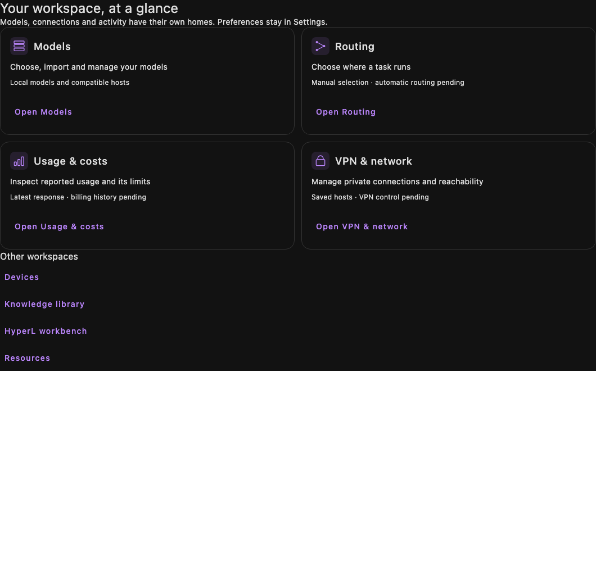

# Studio baseline and first dashboard increment
<!-- meshlit-document-tracking:start -->
Tracking reconciled 2026-10-12: [Plan](../../PLAN.md) · [Progress](../../PROGRESS.md) · [Document status](../DOCUMENTATION_STATUS.md).
Scope: desktop/server; individual acceptance gates apply. Phase labels in older sections retain their original scope.
<!-- meshlit-document-tracking:end -->

## Follow-on usage increment

The in-memory-only usage limitation below describes the first dashboard increment. The subsequent source now includes encrypted usage history, reported input tokens, atomic device-local budget reservations, interruption recovery, manual reconciliation and optional gateway profiles. See [current scope](../USAGE_AND_MODEL_BUDGETS.md). The original destination inventory and initial build evidence remain historical baseline records; new validation is tracked in PROGRESS.md.

Baseline: unified Meshlit `5a7c5167ce6a32880c4e6354fde26af50773eb2c`. The owner authorized implementation on 2026-10-26, superseding the plan-first hold. Existing planning edits are preserved in the same checkout. No publication is requested.

## Source audit

The [captured inventory](STUDIO_BASELINE_2026-10-26.json) contains 69 Studio destinations: 36 declare a scoped source implementation and 33 declare a pending desktop port. These are navigation records, not 36 qualified features. Several destinations share one panel. The inventory was checked against `DesktopDestinations.kt`, `Main.kt` dispatch and `FeatureStatus`; selected provider, routing, usage, model, network and HyperL implementations were inspected directly.

| Priority | Missing or incomplete Studio capability | Observed source | Next backend work |
| --- | --- | --- | --- |
| P0 | Durable sessions and credentials | Chat and host token are session-only; saved endpoints do not store authenticated identity | Encrypted storage, migration/recovery, scoped credential references |
| P0 | Model routing | `router` falls through to the pending-feature panel | Shared policy, bounded dispatch and cancellation; no automatic paid fallback |
| P0 | Usage and budgets | Current response reports optional output tokens and elapsed time | Durable per-attempt journal, unknown-cost accounting, atomic reservation and settlement |
| P0 | Model lifecycle | Local load/import and verified download exist | Resume/storage-failure and actual package/lifecycle qualification |
| P1 | VPN control | Network opens saved endpoints; `core-tunnel` contains a configuration type | Verified official-client observations and explicit handoff; no fake connection status |
| P1 | Provider parity | Compatible host protocols; session keys | Native protocols, optional gateway adapters, capability/account verification |
| P1 | Voice and vision | Media/speech destination backends pending | Real device capture, lifecycle and model/provider adapters |
| P1 | HyperL integration | Native CPU recipes/custom graph workbench exists | Package provenance, native Stop/timeout and memory/measurement qualification |
| P2 | Agents, gateway, hooks and audit | Destination records pending | Shared authority and durable controlled execution before autonomous workflows |
| P2 | Sharding, recovery and peer delivery | Source plans and Android implementations do not provide a Studio executor | Native worker/controller, independent devices, loss/recovery proof |
| Later | VM/containers/Kubernetes, training and OS-level controls | Pending destination records | Actual runtime adapters and individually scoped tests |

## Baseline environment and CI

- JDK: existing Temurin 21.0.12.1; Android SDK includes platform 37.0. Reuse the existing Gradle cache in offline mode first.
- Available disk before building: approximately 22 GiB. Avoid duplicate release packages and model downloads.
- Reuse and hash-verify the existing Qwen2.5 0.5B asset using `prepare-bundled-model.py --source`; no network download is needed.
- [CI 40057473850](https://github.com/sabbirimon/meshlit/actions/runs/40057473850): V1 debug job succeeded. V2 was cancelled in **Separate Core candidate boundary**; its later companion tests were skipped. Earlier steps succeeded. The check annotation confirms the job exceeded its one-hour maximum execution time. This does not establish a failure in the dashboard code or a passing Core Candidate; a focused local boundary test does not close the full CI timeout issue.
- [Multiplatform preview](https://github.com/sabbirimon/meshlit/actions/runs/40057473856) succeeded for the baseline source. Local checks below remain distinct.

## First increment boundary

Implement a task-oriented dashboard entry point and a smaller Basic settings list on both clients. Reuse actual model, routing, device and permission controllers. Preserve search across Advanced and direct destinations. Display unavailable Studio routing and VPN capabilities explicitly; do not represent navigation as a completed backend.

Usage views in this increment may expose only already observed response/route data, labeled with their limited scope. Durable history, account-wide totals, hard budgets and provider billing reconciliation remain G1/G2 work. No sample data or estimated project-completion percentage is added.

Scenario automation, new gateway networking and system VPN mutations are separate implementation slices. This prevents interface cleanup from changing spending, privacy or device permissions.

## Validation record

Results are appended after actual execution. Baseline shared/Studio tests run before source edits; changed source then receives focused contracts, desktop rendering and affected Android checks. Physical device, installed native model and remote provider evidence remain separate from these checks.

### Executed checks so far

- Baseline, before source edits: shared 8 tests; Studio 37 tests with one existing physical-phone skip; zero failures/errors. Command: `:shared-workspace:jvmTest :desktopApp:test` with JDK 21 and the existing cache in offline mode.
- Changed-source run: shared 8, desktop-engine 12, desktop-ssh 4, Studio 39 (one physical-phone skip), Android V1 242 and Android V2 242 tests; zero failures/errors. The original cache lacked EasyQRScan; using the newer existing `~/.gradle` cache resolved that without a download.
- Required core suites: MCP 139, sandbox 14, network 46, inference 284 tests; zero failures/errors.
- Crawler: nine tests passed in the existing crawler environment. System Python lacked FastAPI, so its initial discovery failed; no dependencies were installed.
- HyperL port/alpha.6 provenance and feature-map validation passed. No HyperL runtime source changed or new hardware evidence is claimed.
- Offscreen Studio dashboard renders at 420, 600 and 1060 pixel widths exercise the actual components. Visual review caught uneven card heights and they were aligned before final qualification. These are component renders, not installed-app or Android screenshots.

Build/lint and Core Candidate results follow after completion. Logs are local under `/tmp/meshlit-lts-*`; they are not release artifacts. Runtime source remains uncommitted and no app was installed or published.

### Final qualification

Both debug APK assemblies and both debug lints passed. Each lint report contains zero errors, 399 warnings and 19 hints; no checks were disabled. The focused `BuildProfileTest` passed for `meshlitV2ProductionCandidate`, verifying that only Models appears in that channel's dashboard. This is not a full Core Candidate package/lint or a fix for the GitHub job timeout.

The final qualification command completed successfully in 27m 52s, reusing 190 cached tasks and 539 up-to-date tasks. It included the required core suites, the final Studio render/tests, both debug assemblies/lints and the focused candidate test. Earlier changed-source suites covered both full Android unit suites and shared/desktop-engine/SSH contracts. The only skipped test was the existing physical-phone desktop check. [Machine-readable counts and source digests](evidence/lts-dashboard-validation.json) identify this uncommitted working-tree increment.

Documentation tracking, feature-map, HyperL provenance, whitespace and new-document local-link checks passed. No new dependency/model download, app installation, paid provider request, VPN mutation, commit, push or release was performed. Existing caches, the pinned local model and the crawler environment were reused.

Next: implement G1 durable usage, credential and budget contracts before adding automatic routing or hard spending promises. Current Usage pages are limited in-memory observations; VPN pages are setup/navigation, not a working Tailscale adapter. Installed-app, physical phone and live account qualification remain open.
