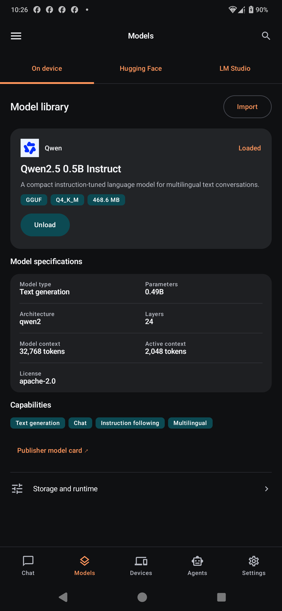
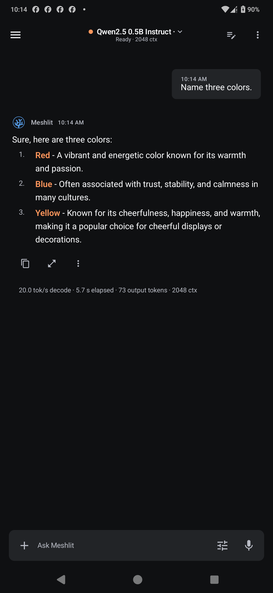
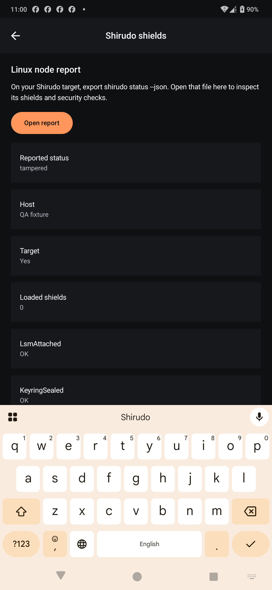

# AQUOS R7 model library and inference checks

Meshlit ran these checks on a physical Sharp AQUOS R7 (A202SH) with 12 GB of RAM and a Snapdragon 8 Gen 1 (SM8450). Android reported eight online CPU cores. The model card and chat screenshots were captured over USB from the installed ARM64 debug build on November 24, 2026.

| Test | Model | Active context | Result |
| --- | --- | ---: | --- |
| Meshlit chat, default Android runner | Qwen2.5 0.5B Instruct Q4_K_M | 2,048 | 73 output tokens, 20.0 decode tokens/s, 5.7 seconds elapsed |
| Native ARM64 runner, four CPU threads | Qwen2.5 0.5B Instruct Q4_K_M | 4,096 | Accepted a 2,206-token prompt without truncation and generated six tokens |
| Native ARM64 runner, four CPU threads | Qwen2.5 1.5B Instruct Q4_K_M | 8,192 | Generated 17 tokens at 18.24 decode tokens/s from a 37-token prompt |

The two larger-window checks ran the Meshlit native server through ADB loopback. The 8,192-token result verifies allocation and short-prompt generation. The 4,096-token test exercised a prompt larger than the default chat window. Decode rates exclude prompt processing and represent individual runs.

| Installed model card | Chat timestamps and reply metrics |
| --- | --- |
|  |  |

[4,096-token run](native-4096-long-prompt.json) · [1.5B model run](native-8192-1.5b.json) · [Qwen’s published model card](https://huggingface.co/Qwen/Qwen2.5-0.5B-Instruct-GGUF) · [Related HyperL projection across Intel, AMD and Adreno GPUs](https://github.com/sabbirimon/HyperL/blob/feature/native-mlir-engine/docs/evidence/intel-amd-adreno-projection-2026-11-24.json)

The packaged native runner passed five consecutive replies, cancellation, and recovery on the R7. [Per-reply timings and token counts](installed-native-repeat.json).

### Shirudo report viewer

The AQUOS R7 opened a schema 1 JSON fixture through the Android file picker. The screenshot shows the supplied `tampered` verdict and the `ChainIntact` alert. This checks the viewer on physical hardware. Live shield enforcement requires a configured Linux target.

